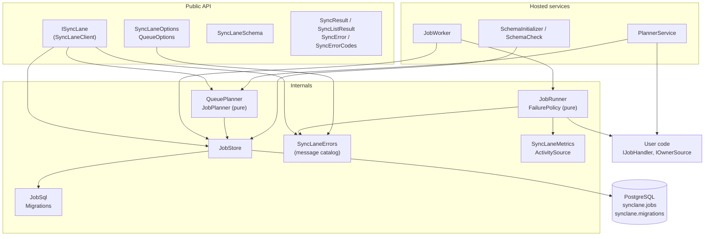

# Architecture

This page explains how SyncLane is built and why. [CLAUDE.md](CLAUDE.md) turns it into rules; [docs/how-it-works.md](docs/how-it-works.md) walks through the SQL behind each step.

## What SyncLane is, and is not

SyncLane is a library that syncs data from other people's APIs on behalf of many accounts. It cuts history into windows, runs each window as a job page by page, saves the cursor after every page, keeps one job per lane running at a time, and retries with backoff. All state lives in one PostgreSQL table that the user owns.

It is a developer kit, not a service. It runs in the user's process, with the user's credentials, against the user's database, and sends nothing anywhere else. It does not transform data, does not host anything, and does not promise exactly-once delivery.

## Priorities

When two goals conflict, the higher one wins:

1. **Job state is never lost or doubled.** A cursor never goes backwards, a planned job exists once, a lane never runs two jobs. These are enforced by the database, not by code paths.
2. **Security.** Nothing leaves the user's infrastructure. Secrets, headers, bodies and cursors stay out of logs, traces and messages.
3. **Performance.** One round trip per operation, indexes for every hot query, no cost for unused features.
4. **Ease of use.** Few concepts, one line to wire up, errors that say how to fix them.

Ease of use is last on purpose: an easy API that loses a cursor is worse than a slightly longer one that does not.

## Components



| Component | Responsibility | Changes when |
| --- | --- | --- |
| `SyncLaneOptions`, `QueueOptions` | Declare queues and job types; validate at start-up. | A new setting is added. |
| `JobPlanner` | Pure function: given what exists, which jobs are missing. | The planning rule changes. |
| `QueuePlanner` | One read for coverage, one insert for what is missing. | Planning needs more data. |
| `PlannerService` | Calls the owner sources and plans every queue each interval. | Scheduling of planning changes. |
| `JobWorker` | Runs `Concurrency` slots per queue; each slot leases and runs jobs. | Slot scheduling changes. |
| `JobRunner` | Runs one leased job: pages, checkpoints, heartbeat, outcome. | The page loop changes. |
| `FailurePolicy` | Pure function: failed attempt to next status and delay. | Retry behaviour changes. |
| `JobSql` | Every SQL statement, built once for the configured schema. | A query changes. |
| `JobStore` | Executes statements; every write to a held job is conditional on still holding it. | Table access changes. |
| `Migrations` | The schema as an append-only list of idempotent steps. | The table changes. |
| `SyncLaneErrors` | Every error message, with its code and kind. | An error is added or reworded. |
| `SyncLaneMetrics`, `SyncLaneTelemetry` | Metrics and spans through `System.Diagnostics`. | A signal is added. |
| `SyncLaneClient` | `ISyncLane`: validates input, returns results. | The public API changes. |

### Dependency direction

Dependencies point inwards and downwards. A lower row never references a higher one.

| Layer | May use |
| --- | --- |
| Public API (`ISyncLane`, options, results, errors) | Planning, Storage, Errors |
| Hosted services | Planning, Running, Storage, Telemetry |
| Running | Storage, Errors, Telemetry, user handlers |
| Planning | Storage |
| Storage | Npgsql, Errors |
| Errors, Results, Telemetry | BCL only |

User code reaches SyncLane through two small interfaces and one facade: `IJobHandler`, `IOwnerSource` and `ISyncLane`.

`SyncLane.Http` sits on top and uses only the engine's public API, the same way user code does. A recipe is compiled once when it is loaded (`CompiledRecipe`); building the request of a page (`RequestRenderer`) does no parsing and checks only the values that change per job. Placeholder values are escaped for where they land, and a recipe's host is fixed text, so a recipe can only call the host it names.

## Data model

Two tables in the configured schema.

`jobs` holds one row per job: what it covers (`queue`, `owner`, `lane`, `type`, `mode`, `window_start`, `window_end`, `dedup_key`), where it is (`status`, `cursor`, `processed_count`, `attempt_count`, `error`, `next_run_at`) and who holds it (`leased_by`, `lease_expires_at`, `heartbeat_at`). The full definition is in [docs/schema.sql](docs/schema.sql).

`migrations` records which schema steps the database has.

The guarantees are indexes, not code:

| Index | Guarantee |
| --- | --- |
| `UNIQUE (queue, owner, type, dedup_key)` | A planned job is created once, however many instances plan at once. |
| `UNIQUE (queue, lane) WHERE status = 'running'` | One running job per lane, across every process. |
| `(queue, next_run_at) WHERE status IN (...)` | Finding the next due job stays cheap as completed rows pile up. |

Every write a worker makes to a job carries `WHERE id = @id AND status = 'running' AND leased_by = @worker`. A worker whose lease was taken over cannot overwrite the new holder; its writes match no row and it stops.

## Concurrency model

- **Slots.** Each process runs `Concurrency` slots per queue. A slot takes one job, runs it to an end and takes the next.
- **Leases.** Taking a job is one `UPDATE … WHERE id = (SELECT … FOR UPDATE SKIP LOCKED)`. A heartbeat renews the lease every third of `LeaseDuration`. A dead worker's job is taken over once its lease expires.
- **Lanes.** A slot never takes a job whose lane already has one running. Two slots racing for one lane both try; the unique index lets one through and the other retries.
- **Pages.** Pages of one job run in sequence because each starts from the previous cursor. That is the only ordering SyncLane imposes inside a job.
- **Planning.** Every interval, all queues are planned at the same time. Planning from several instances at once is safe because the insert ignores conflicts.
- **Awaiting in loops.** Independent work is batched into one statement or awaited together. A loop awaits in sequence only when order is the point, and says so in a `// Sequential:` comment. `ConventionTests` checks this.

## Error model

Every failure belongs to one category, and the category decides the mechanism:

| Category | Mechanism | Who handles it |
| --- | --- | --- |
| Expected outcome of a call (unknown queue, duplicate, bad limit) | Failed `SyncResult` with a `SyncError` | The caller, by branching on `Succeeded` or the code |
| Configuration (missing setting, missing migration) | `SyncLaneException` at start-up | The developer, before the application serves anything |
| Caller bug (`null` argument) | `ArgumentNullException` from BCL helpers | The developer |
| Infrastructure (database, network) | The original exception propagates | The caller; inside a worker, the retry policy |
| Handler failure | Stored in the job's `error` column | The retry policy, then a person via requeue |
| Cancellation | `OperationCanceledException` | Nobody; it is not a failure |
| Impossible state | `SyncLaneException` with kind `Internal` | A bug report |

The point of the split: a failed result always means "the call was understood and the answer is no". It never means "something broke". Callers can handle every failed result without fearing they are hiding an outage.

### Codes and the catalog

Every SyncLane error has a stable code, `SL` plus four digits. The first digit is the area: 1 configuration, 2 schema and stored data, 3 calls to `ISyncLane`, 4 running jobs, 5 the HTTP source. Each package lists its codes in one class (`SyncErrorCodes`, `HttpErrorCodes`), and every code is documented with cause and fix in [docs/errors.md](docs/errors.md).

All messages of a package are written in one place: `SyncLaneErrors` in the engine, `HttpErrors` in the HTTP source. One catalog means:

- the same problem is always worded the same way, in exceptions, results, logs and the `error` column;
- every message follows the same form: what went wrong, then how to fix it;
- a reviewer can read every error the library can produce in one file;
- applications can translate by code: the code is the localization key, the English message is the fallback.

`SyncError.ToString()` is `"{Code}: {Message}"`, and that is the form used everywhere text is needed.

`SyncErrorKind` says what kind of problem it is, and `ToHttpStatusCode()` gives the status an API built on SyncLane would usually answer with:

| Kind | HTTP |
| --- | --- |
| `Validation` | 400 |
| `Unauthorized` | 401 |
| `NotFound` | 404 |
| `Conflict` | 409 |
| `Throttled` | 429 |
| `Unavailable` | 503 |
| `Configuration`, `Internal` | 500 |

## Result model

```csharp
public class SyncResult                      // Succeeded, Errors, Error, ThrowIfFailed()
public sealed class SyncResult<T>     : SyncResult   // + Value, GetValueOrThrow()
public sealed class SyncListResult<T> : SyncResult   // + Items, NextCursor, HasMore, Total
```

A typical call:

```csharp
var result = await syncLane.EnqueueAsync(new NewJob { Queue = "shops", Owner = owner, Type = "orders", DedupKey = "resync-2026-10" });

if (!result.Succeeded)
    return result.Error!.Code == SyncErrorCodes.JobAlreadyExists
        ? Results.Ok("Already queued")
        : Results.Problem(result.Error.Message, statusCode: result.Error.Kind.ToHttpStatusCode());

return Results.Ok(result.Value);
```

Choices, and why:

- **Typed errors, not strings.** Callers branch on `Code` and `Kind`; a list of strings can only be shown.
- **Immutable.** Results are created by `Success` and `Failure` and never change, so they are safe to cache and share between threads.
- **`Value` and `Items`, not `Result`.** `result.Result` reads badly and is easily confused with `Task.Result`.
- **Own names, prefixed with `Sync`.** Applications often have their own `Result` or `ApiResult` type, frequently from a shared in-house package. A SyncLane type with the same name would make every file that imports both ambiguous.
- **Cursor pages.** `SyncListResult<T>` carries `NextCursor` instead of a page number, because an offset gets slower the deeper it goes and skips or repeats rows when new ones arrive. `Total` is only filled when asked for, because counting a large table is not free.
- **No dependency on in-house packages.** SyncLane is public and builds on its own. An application that answers with `ApiResult<T>` maps in its own code, or in an adapter package kept in a separate solution:

```csharp
// In the application or a separate adapter solution, never in SyncLane.
static ApiResult<T> ToApiResult<T>(this SyncResult<T> result) =>
    result.Succeeded
        ? ApiResult<T>.Success(result.Value!)
        : ApiResult<T>.Failure(result.Errors.Select(error => error.ToString()));
```

## Performance model

Round trips per operation:

| Operation | Round trips | Served by |
| --- | --- | --- |
| Take a job | 1 (up to 3 when racing for a lane) | `jobs_due`, `jobs_one_running_per_lane` |
| Save a page | 1 | Primary key |
| Heartbeat | 1 per third of `LeaseDuration` | Primary key |
| Finish a job | 1 | Primary key |
| Plan a queue | 2: coverage read, batched insert | `jobs_dedup` |
| `EnqueueAsync` | 1 | `jobs_dedup` |
| `GetJobsAsync` | 1, with the optional count in the same batch | Primary key, scanned backwards |
| `RequeueAsync`, `CancelAsync`, `GetProgressAsync` | 1 | `jobs_dedup` prefix |
| Start-up migration | 3, in one transaction | |

Known limits:

- `GetJobsAsync` filtered by owner or status walks the primary key backwards and filters. That is fine for admin screens. If it becomes hot, add an index on `(queue, owner, id)` in a migration.
- Workers poll every `PollInterval`. `LISTEN`/`NOTIFY` would cut the wait for new jobs; it is on the ideas list.
- Telemetry costs nothing without a listener: instruments and spans are no-ops until something subscribes.

## Security model

Trust boundaries and what crosses them:

| Boundary | What crosses | Rule |
| --- | --- | --- |
| Configuration to SyncLane | Connection string, schema name | The connection string is never logged. The schema name must match `^[a-z_][a-z0-9_]{0,62}$` before it reaches SQL. |
| SyncLane to PostgreSQL | Job state | Values are always parameters. Only the validated schema name is interpolated. |
| SyncLane to user handlers | The `Job` row | Handlers look up credentials themselves; SyncLane never sees them. |
| Handler exceptions to the table | Exception type and message | Capped at 2,000 characters. Handlers must not put secrets in exception messages ([SECURITY.md](SECURITY.md)). |
| SyncLane to observability | Metrics, spans, logs | Queue and type only. Never owner, lane, cursor, headers or bodies. |
| SyncLane to the internet | Nothing | No telemetry home, no license check, no update check. |

Anyone who can write to the `jobs` table can make workers run a handler for any owner. Treat write access to it like access to the application.

## Extension points

Each is a small interface the user implements; SyncLane calls it.

| Interface | Status | Purpose |
| --- | --- | --- |
| `IJobHandler` | Available | Run one page of a job and return the next cursor. |
| `IOwnerSource` | Available | List the accounts a queue should plan for. |
| `IRecordSink` | Available in `SyncLane.Http` | Write the records of a page. Ready-made sinks (PostgreSQL `jsonb`, HTTP POST) are phase 3. |
| `IRequestSigner` | Planned, phase 1 | Sign an outgoing request for platforms that require it. |
| `ICredentialStore` | Planned, phase 1 | Keep credentials encrypted, outside the jobs table. |
| Rate budgets | Proposed, phase 2 | See [docs/design/rate-budgets.md](docs/design/rate-budgets.md). |

## Packages

| Package | Contents | Status |
| --- | --- | --- |
| `SyncLane` | Engine: planning, running, storage, results, errors, telemetry | This repository |
| `SyncLane.Http` | Declarative HTTP source: recipes, pagination, auth, rate budgets | In progress: recipes run one page per job ([docs/recipes.md](docs/recipes.md)) |
| `SyncLane.Sinks.*` | Destinations | Planned |
| `SyncLane.Cli` | `init --curl`, `probe`, `test` | Planned |
| Adapters to in-house packages | For example `SyncResult` to `ApiResult` | Separate solution, never in this one |

## Decision log

| # | Decision | Why | Status |
| --- | --- | --- | --- |
| D1 | PostgreSQL only | The guarantees rest on `FOR UPDATE SKIP LOCKED` and partial unique indexes. | Accepted |
| D2 | One table for all job state | State the user can read with `SELECT` and fix with `UPDATE`. | Accepted |
| D3 | At-least-once pages | Exactly-once across an external API is not possible without the API's help; upserts make repeats harmless. | Accepted |
| D4 | Apache License 2.0 | Permissive, with an explicit patent grant; warranty disclaimer and liability limit as in MIT. | Accepted |
| D5 | Results for expected failures, exceptions for everything else | A failed result must never hide an outage. | Accepted |
| D6 | Own result types, no in-house packages | The library is public and must build alone; names must not collide with applications' own types. | Accepted |
| D7 | Cursor pagination, total on request | Constant cost per page; no `COUNT(*)` by default. | Accepted |
| D8 | Telemetry through `System.Diagnostics` | No dependency; works with OpenTelemetry, Prometheus exporters and `dotnet-counters`. | Accepted |
| D9 | Append-only, idempotent migrations | Safe rolling deploys and safe hand-applied scripts. | Accepted |
| D10 | One message catalog with stable codes | Consistent wording, searchable docs, localization by code. | Accepted |
| D11 | Interfaces only at extension points | Testing against real PostgreSQL makes internal interfaces cost without benefit. | Accepted |
| D12 | Rate budgets separate from lanes | Lanes serialise; shared limits should not. | Proposed |
| D13 | `SyncLane.Http` depends on `Microsoft.Extensions.Http` | `IHttpClientFactory` manages connection lifetimes and lets users add handlers to a named client; writing that ourselves would be worse. Maintained by Microsoft, MIT licensed. The engine does not take the dependency. | Accepted |
| D14 | The HTTP source follows no redirects | A redirect could carry a recipe's headers to another host, and would break the rule that a recipe only calls the host it names. | Accepted |
