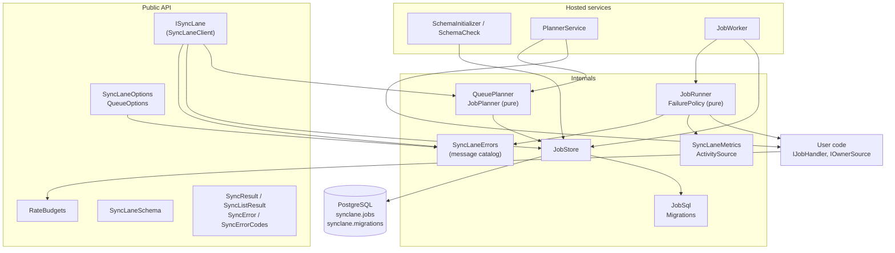

# Architecture

This page explains how SyncLane is built and why. [CLAUDE.md](CLAUDE.md) turns it into rules; [docs/how-it-works.md](docs/how-it-works.md) walks through the SQL behind each step.

## What SyncLane is, and is not

SyncLane is a library that syncs data from other people's APIs on behalf of many accounts. It cuts history into windows, runs each window as a job page by page, saves the cursor after every page, keeps one job per lane running at a time, and retries with backoff. All state lives in one PostgreSQL table that the user owns.

It is a developer kit, not a service. It runs in the user's process, with the user's credentials, against the user's database, and sends nothing anywhere else. It does not transform data, does not host anything, and does not promise exactly-once delivery.

## Priorities

When two goals conflict, the higher one wins:

1. **Job state is never lost or doubled.** A cursor never goes backwards, a planned job exists once, a lane never runs two jobs. These are enforced by the database, not by code paths.
2. **Security.** Nothing leaves the user's infrastructure. Secrets, headers, bodies and cursors stay out of logs, traces and messages.
3. **Performance.** One round trip per operation, indexes for every hot query, no cost for unused features.
4. **Ease of use.** Few concepts, one line to wire up, errors that say how to fix them.

Ease of use is last on purpose: an easy API that loses a cursor is worse than a slightly longer one that does not.

## Components



| Component | Responsibility | Changes when |
| --- | --- | --- |
| `SyncLaneOptions`, `QueueOptions` | Declare queues and job types; validate at start-up. | A new setting is added. |
| `JobPlanner` | Pure function: given what exists, which jobs are missing. | The planning rule changes. |
| `QueuePlanner` | One read for coverage, one insert for what is missing. | Planning needs more data. |
| `PlannerService` | Calls the owner sources and plans every queue each interval. | Scheduling of planning changes. |
| `JobWorker` | Runs `Concurrency` slots per queue; each slot leases and runs jobs. | Slot scheduling changes. |
| `JobRunner` | Runs one leased job: pages, checkpoints, heartbeat, outcome. | The page loop changes. |
| `FailurePolicy` | Pure function: failed attempt to next status and delay. | Retry behaviour changes. |
| `RateBudgets` | One token bucket per budget and key, shared by every instance: requests wait for tokens, a `429` pauses the bucket and lowers its rate, and the rate climbs back below the declared limit. | The learning rule changes, after a new measurement. |
| `JobSql`, `BudgetSql` | Every SQL statement, built once for the configured schema. | A query changes. |
| `JobStore` | Executes job statements; every write to a held job is conditional on still holding it. Owns the connection pool. | Table access changes. |
| `BudgetStore` | Executes bucket statements, each one round trip that locks the bucket's row. | Bucket access changes. |
| `Migrations` | The schema as an append-only list of idempotent steps. | The table changes. |
| `SyncLaneErrors` | Every error message, with its code and kind. | An error is added or reworded. |
| `SyncLaneMetrics`, `SyncLaneTelemetry` | Metrics and spans through `System.Diagnostics`. | A signal is added. |
| `SyncLaneClient` | `ISyncLane`: validates input, returns results. | The public API changes. |

### Dependency direction

Dependencies point inwards and downwards. A lower row never references a higher one.

| Layer | May use |
| --- | --- |
| Public API (`ISyncLane`, options, results, errors) | Planning, Storage, Errors |
| Hosted services | Planning, Running, Storage, Telemetry |
| Running | Storage, Errors, Telemetry, user handlers |
| Planning | Storage |
| Storage | Npgsql, Errors |
| Errors, Results, Telemetry | BCL only |

User code reaches SyncLane through two small interfaces and one facade: `IJobHandler`, `IOwnerSource` and `ISyncLane`.

`SyncLane.Http` sits on top and uses only the engine's public API, the same way user code does. A recipe is compiled once when it is loaded (`CompiledRecipe`); building the request of a page (`RequestRenderer`) does no parsing and checks only the values that change per job. Placeholder values are escaped for where they land, and a recipe's host is fixed text, so a recipe can only call the host it names.

## Data model

Ten tables in the configured schema.

`jobs` holds one row per job: what it covers (`queue`, `owner`, `lane`, `type`, `mode`, `window_start`, `window_end`, `dedup_key`), where it is (`status`, `cursor`, `processed_count`, `attempt_count`, `error`, `next_run_at`) and who holds it (`leased_by`, `lease_expires_at`, `heartbeat_at`). The full definition is in [docs/schema.sql](docs/schema.sql).

`coverage` holds one row per queue, owner and type: what has been planned (an initial job exists, the oldest initial start, the newest window end, the last planned and last recurring times) and how far completed data reaches (`completed_to`, `completed_at`). The planner reads it instead of every job ever created. It is written by the same statement that inserts jobs (D40), so old jobs can be deleted without changing what is planned.

`job_stats` counts, per queue, job type and hour: completed jobs, their records, failed attempts and abandoned jobs. The statements that complete and settle a job update it (D45). It is kept for 400 days, long after clean-up deletes the jobs, and the monitor's overview and volume read it instead of jobs.

`pauses` holds the pauses in force, one row per queue (owner empty) or owner, with who paused it, why and until when. Workers obey it (D49).

`actions` logs what operators did through the monitor: pause, resume, budget limits and every repair, with who, why and how many jobs changed. Kept for 400 days.

`budget_limits` holds operators' temporary limits on rate budgets, one row per budget and key (empty for every key), with who set it, why and until when. `rate_buckets.reported_rate` holds the limit the API last reported for the key. Together they make a bucket's ceiling (D50).

`owners` holds one row per queue and owner SyncLane has seen, with the name its owner source or an enqueue last gave it. The planning round writes it in the same batch as the summary read; the monitor shows the name and searches this table before it reads any job (D52).

`instances` holds one row per running process: its application, host, version, the queues it runs and its budgets, with a heartbeat every 30 seconds. Its id is the prefix of the worker names in `jobs.leased_by`. It keeps two applications off one queue (D43) and shows what is running. A process that stops marks its row stopped and the row stays for a day (D53).

`migrations` records which schema steps the database has.

`rate_buckets` holds one row per rate budget and key: the tokens left, when they were last refilled (in the future while the bucket is paused), how many pauses it has had (`generation`), how many tokens it has given (`taken`), and its learned rate (`rate`, with `rate_max`, the rate that last caused a throttle). Its primary key `(budget, key)` serves every statement on it.

The guarantees are indexes, not code:

| Index | Guarantee |
| --- | --- |
| `UNIQUE (queue, owner, type, dedup_key)` | A planned job is created once, however many instances plan at once. |
| `UNIQUE (queue, lane) WHERE status = 'running'` | One running job per lane, across every process. |
| `(queue, next_run_at) WHERE status IN (...)` | Finding the next due job stays cheap as completed rows pile up. |
| `jobs_open (queue, owner, type) WHERE status <> 'completed'` | The planner sees what is still under way per owner and type without reading history. |
| `jobs_finished (queue, completed_at) WHERE status = 'completed' AND mode <> 'initial'` | Clean-up finds old jobs without scanning the table. |
| `jobs_initial (queue, owner, type) INCLUDE (status) WHERE mode = 'initial'` | Progress and the monitor count an owner's history without reading its recurring jobs. |
| `jobs_owner (queue, owner, id)` | A search lists the newest jobs of the owners it finds without walking the table. |

Every write a worker makes to a job carries `WHERE id = @id AND status = 'running' AND leased_by = @worker`. A worker whose lease was taken over cannot overwrite the new holder; its writes match no row and it stops.

## Concurrency model

- **Slots.** Each process runs `Concurrency` slots per queue. A slot takes one job, runs it to an end and takes the next.
- **Leases.** Taking a job is one `UPDATE … WHERE id = (SELECT … FOR UPDATE SKIP LOCKED)`. A heartbeat renews the lease every third of `LeaseDuration`. A dead worker's job is taken over once its lease expires.
- **Lanes.** A slot never takes a job whose lane already has one running. Two slots racing for one lane both try; the unique index lets one through and the other retries.
- **Pages.** Pages of one job run in sequence because each starts from the previous cursor. That is the only ordering SyncLane imposes inside a job.
- **Planning.** Every interval, all queues are planned at the same time. Planning from several instances at once is safe because the insert ignores conflicts.
- **Awaiting in loops.** Independent work is batched into one statement or awaited together. A loop awaits in sequence only when order is the point, and says so in a `// Sequential:` comment. `ConventionTests` checks this.

## Error model

Every failure belongs to one category, and the category decides the mechanism:

| Category | Mechanism | Who handles it |
| --- | --- | --- |
| Expected outcome of a call (unknown queue, duplicate, bad limit) | Failed `SyncResult` with a `SyncError` | The caller, by branching on `Succeeded` or the code |
| Configuration (missing setting, missing migration) | `SyncLaneException` at start-up | The developer, before the application serves anything |
| Caller bug (`null` argument) | `ArgumentNullException` from BCL helpers | The developer |
| Infrastructure (database, network) | The original exception propagates | The caller; inside a worker, the retry policy |
| Handler failure | Stored in the job's `error` column | The retry policy, then a person via requeue |
| Cancellation | `OperationCanceledException` | Nobody; it is not a failure |
| Impossible state | `SyncLaneException` with kind `Internal` | A bug report |

The point of the split: a failed result always means "the call was understood and the answer is no". It never means "something broke". Callers can handle every failed result without fearing they are hiding an outage.

### Codes and the catalog

Every SyncLane error has a stable code, `SL` plus four digits. The first digit is the area: 1 configuration, 2 schema and stored data, 3 calls to `ISyncLane`, 4 running jobs, 5 the HTTP source. Each package lists its codes in one class (`SyncErrorCodes`, `HttpErrorCodes`), and every code is documented with cause and fix in [docs/errors.md](docs/errors.md).

All messages of a package are written in one place: `SyncLaneErrors` in the engine, `HttpErrors` in the HTTP source. One catalog means:

- the same problem is always worded the same way, in exceptions, results, logs and the `error` column;
- every message follows the same form: what went wrong, then how to fix it;
- a reviewer can read every error the library can produce in one file;
- applications can translate by code: the code is the localization key, the English message is the fallback.

`SyncError.ToString()` is `"{Code}: {Message}"`, and that is the form used everywhere text is needed.

`SyncErrorKind` says what kind of problem it is, and `ToHttpStatusCode()` gives the status an API built on SyncLane would usually answer with:

| Kind | HTTP |
| --- | --- |
| `Validation` | 400 |
| `Unauthorized` | 401 |
| `NotFound` | 404 |
| `Conflict` | 409 |
| `Throttled` | 429 |
| `Unavailable` | 503 |
| `Configuration`, `Internal` | 500 |

## Result model

```csharp
public class SyncResult                      // Succeeded, Errors, Error, ThrowIfFailed()
public sealed class SyncResult<T>     : SyncResult   // + Value, GetValueOrThrow()
public sealed class SyncListResult<T> : SyncResult   // + Items, NextCursor, HasMore, Total
```

A typical call:

```csharp
var result = await syncLane.EnqueueAsync(new NewJob { Queue = "shops", Owner = owner, Type = "orders", DedupKey = "resync-2026-10" });

if (!result.Succeeded)
    return result.Error!.Code == SyncErrorCodes.JobAlreadyExists
        ? Results.Ok("Already queued")
        : Results.Problem(result.Error.Message, statusCode: result.Error.Kind.ToHttpStatusCode());

return Results.Ok(result.Value);
```

Choices, and why:

- **Typed errors, not strings.** Callers branch on `Code` and `Kind`; a list of strings can only be shown.
- **Immutable.** Results are created by `Success` and `Failure` and never change, so they are safe to cache and share between threads.
- **`Value` and `Items`, not `Result`.** `result.Result` reads badly and is easily confused with `Task.Result`.
- **Own names, prefixed with `Sync`.** Applications often have their own `Result` or `ApiResult` type, frequently from a shared in-house package. A SyncLane type with the same name would make every file that imports both ambiguous.
- **Cursor pages.** `SyncListResult<T>` carries `NextCursor` instead of a page number, because an offset gets slower the deeper it goes and skips or repeats rows when new ones arrive. `Total` is only filled when asked for, because counting a large table is not free.
- **No dependency on in-house packages.** SyncLane is public and builds on its own. An application that answers with `ApiResult<T>` maps in its own code, or in an adapter package kept in a separate solution:

```csharp
// In the application or a separate adapter solution, never in SyncLane.
static ApiResult<T> ToApiResult<T>(this SyncResult<T> result) =>
    result.Succeeded
        ? ApiResult<T>.Success(result.Value!)
        : ApiResult<T>.Failure(result.Errors.Select(error => error.ToString()));
```

## Performance model

Round trips per operation:

| Operation | Round trips | Served by |
| --- | --- | --- |
| Take a job | 1 (up to 3 when racing for a lane) | `jobs_due`, `jobs_one_running_per_lane` |
| Save a page | 1 | Primary key |
| Heartbeat | 1 per third of `LeaseDuration` | Primary key |
| Finish a job | 1 | Primary key |
| Plan a queue | 2: the owners and their names written and the summary read in one batch, then one insert that also replaces abandoned recurring jobs and updates the summary. An unchanged name writes nothing | `owners` and `coverage` primary keys, `jobs_open`, `jobs_dedup` |
| `MarkLoadedAsync` | 1 | `jobs_dedup`, `coverage` primary key |
| `ForgetOwnerAsync` | 1 | `jobs_dedup` prefix, `coverage` primary key |
| Clean-up | 1 per batch of 1,000, hourly | `jobs_finished` |
| Register an instance | 2 at start-up, in one transaction behind an advisory lock | `instances`, a handful of rows |
| Heartbeat | 1 every 30 seconds, also deleting rows silent for a day | `instances` primary key |
| Announce a job change | 0: the trigger runs inside the write | |
| Listen for changes | 1 long-lived connection per process, a `SELECT 1` every 30 quiet seconds | |
| Monitor repairs | 1 each, the action logged in the same statement | Primary key; `jobs_open` for a code or an owner |
| Pause, resume | 1, announced in the same statement | `pauses` primary key |
| Monitor reads | 1 each. Measured on a million jobs: overview 0.2 ms, freshness page 0.9 ms, problems 0.3 ms, a week by hour 0.8 ms, 400 days by day 46 ms | `coverage`, `job_stats`, `jobs_open`, `jobs_initial`, `rate_buckets`, `instances` |
| `EnqueueAsync` | 1 | `jobs_dedup` |
| `GetJobsAsync` | 1, with the optional count in the same batch. With `Search`: the matching owners from `owners`, then each one's newest jobs. Measured on a million jobs and a thousand owners: 0.3 ms when nothing matches, 0.4 ms for one owner, 18 ms when every owner matches, where filtering the jobs instead took 190 ms | Primary key, scanned backwards; `jobs_owner` for a search |
| `RequeueAsync`, `CancelAsync`, `GetProgressAsync` | 1 | `jobs_dedup` prefix |
| Start-up migration | 3, in one transaction | |
| Take a budget's token | 1, plus 1 read after a wait to check for a pause | `rate_buckets` primary key |
| Pause a budget after a `429` | 1 | `rate_buckets` primary key |
| Report what an answer said is left | 1, only when the recipe names rate headers; writes only when the reading lowers the bucket | `rate_buckets` primary key |

Known limits:

- `GetJobsAsync` filtered only by status or type walks the primary key backwards and filters. That is fine for admin screens. Filtered by an owner it uses `jobs_owner` or `jobs_dedup`; a search finds owners first.
- The count a search asks for (`IncludeTotal`) counts every job of the matching owners: 77 ms when all of a million jobs match. Ask for it on the first page only.
- Every status change is announced with `NOTIFY` (D47). On this machine, eight connections doing nothing but changing statuses managed 33,000 changes a second without it and 24,000 with it, because PostgreSQL commits notifying transactions one at a time. A job changes status a few times in a life of hundreds of milliseconds of API calls, so a thousand changes a second is 4% of that ceiling. Where it matters, `ALTER TABLE synclane.jobs DISABLE TRIGGER jobs_announce_status` turns it off; workers then poll.
- Telemetry costs nothing without a listener: instruments and spans are no-ops until something subscribes.

## Security model

Trust boundaries and what crosses them:

| Boundary | What crosses | Rule |
| --- | --- | --- |
| Configuration to SyncLane | Connection string, schema name | The connection string is never logged. The schema name must match `^[a-z_][a-z0-9_]{0,62}$` before it reaches SQL. |
| SyncLane to PostgreSQL | Job state | Values are always parameters. Only the validated schema name is interpolated. |
| SyncLane to user handlers | The `Job` row | Handlers look up credentials themselves; SyncLane never sees them. |
| Credential store to `SyncLane.Http` | One owner's credential, for one page | Added to the request only. Never stored, logged, traced or put in a message. OAuth 2.0 access tokens are kept in memory, never written. |
| `SyncLane.Http` to an API | Requests carrying credentials | Only to the recipe's host and its token URL, both fixed text, or to one of the hosts the recipe lists when the host is made from the owner's values, checked before every request (D60). No redirects; next-page URLs on another host are refused; a signer cannot move a request. |
| API answers to the table | Error messages and cursors | Messages never quote a body, a URL or a network exception's text. A query-string key is taken out of next-page URLs before they become cursors. |
| Handler exceptions to the table | Exception type and message | Capped at 2,000 characters. Handlers must not put secrets in exception messages ([SECURITY.md](SECURITY.md)). |
| SyncLane to observability | Metrics, spans, logs | Queue, type and budget name only. Never owner, lane, budget key, cursor, headers or bodies. |
| SyncLane to the internet | Nothing of its own | No telemetry home, no license check, no update check. `SyncLane.Http` calls only the hosts your recipes name. |

Anyone who can write to the `jobs` table can make workers run a handler for any owner. Treat write access to it like access to the application.

## Extension points

Each is a small interface the user implements; SyncLane calls it.

| Interface | Status | Purpose |
| --- | --- | --- |
| `IJobHandler` | Available | Run one page of a job and return the next cursor. |
| `IOwnerSource` | Available | List the accounts a queue should plan for. |
| `IRecordSink` | Available in `SyncLane.Http` | Write the records of a page. `WriteToPostgres` and `WriteToHttp` are built in; `RecordIdentity` gives custom sinks the same keys, versions and duplicate removal, and `SinkConformance` checks them against replays. |
| `ICredentialStore` | Available in `SyncLane.Http` | Give an owner's credential for a page, and save a rotated refresh token. Credentials stay in the user's storage, outside the jobs table. |
| `IRequestSigner` | Available in `SyncLane.Http` | Sign an outgoing request for APIs that require it. May add headers and query parameters, never move the request. |
| Rate budgets | Available | `RateBudgets` for hand-written handlers, `rate` in recipes. |

## Packages

| Package | Contents | Status |
| --- | --- | --- |
| `SyncLane` | Engine: planning, running, storage, results, errors, telemetry | This repository |
| `SyncLane.Http` | Declarative HTTP source: recipes, pagination, auth, rate budgets, the PostgreSQL and HTTP destinations | Preview: recipes run, page and authenticate ([docs/recipes.md](docs/recipes.md)); checked against five public APIs ([samples/LiveCheck](samples/LiveCheck)) |
| `SyncLane.AspNetCore` | `MapSyncLane`: the monitor's reads, repairs and live stream over HTTP, listed in the host's OpenAPI document | Preview |
| `SyncLane.Sinks.*` | Destinations for other databases, one package each, on the public `RecordIdentity` | Planned |
| `SyncLane.Cli` | The `synclane` command: `init` turns a curl into a recipe, `test` runs one for two pages | Preview ([docs/recipes.md](docs/recipes.md#starting-from-a-curl)) |
| Adapters to in-house packages | For example `SyncResult` to `ApiResult` | Separate solution, never in this one |

## Decision log

| # | Decision | Why | Status |
| --- | --- | --- | --- |
| D1 | PostgreSQL only | The guarantees rest on `FOR UPDATE SKIP LOCKED` and partial unique indexes. | Accepted |
| D2 | One table for all job state | State the user can read with `SELECT` and fix with `UPDATE`. | Accepted |
| D3 | At-least-once pages | Exactly-once across an external API is not possible without the API's help; upserts make repeats harmless. | Accepted |
| D4 | Apache License 2.0 | Permissive, with an explicit patent grant; warranty disclaimer and liability limit as in MIT. | Accepted |
| D5 | Results for expected failures, exceptions for everything else | A failed result must never hide an outage. | Accepted |
| D6 | Own result types, no in-house packages | The library is public and must build alone; names must not collide with applications' own types. | Accepted |
| D7 | Cursor pagination, total on request | Constant cost per page; no `COUNT(*)` by default. | Accepted |
| D8 | Telemetry through `System.Diagnostics` | No dependency; works with OpenTelemetry, Prometheus exporters and `dotnet-counters`. | Accepted |
| D9 | Append-only, idempotent migrations | Safe rolling deploys and safe hand-applied scripts. | Accepted |
| D10 | One message catalog with stable codes | Consistent wording, searchable docs, localization by code. | Accepted |
| D11 | Interfaces only at extension points | Testing against real PostgreSQL makes internal interfaces cost without benefit. | Accepted |
| D12 | Rate budgets separate from lanes | Lanes serialise; shared limits should not. | Accepted |
| D13 | `SyncLane.Http` depends on `Microsoft.Extensions.Http` | `IHttpClientFactory` manages connection lifetimes and lets users add handlers to a named client; writing that ourselves would be worse. Maintained by Microsoft, MIT licensed. The engine does not take the dependency. | Accepted |
| D14 | The HTTP source follows no redirects | A redirect could carry a recipe's headers to another host, and would break the rule that a recipe only calls the host it names. | Accepted |
| D15 | Credentials never in a recipe or the jobs table; an `ICredentialStore` gives them per owner, once per page | A recipe is meant to be shared and committed, and the jobs table is read by dashboards and support staff. Asking per page makes a rotated or revoked credential count at once; a store that is slow to ask can cache. | Accepted |
| D16 | OAuth 2.0 access tokens live in memory only | Writing them down would add a table of live secrets to protect. A restart costs one token request per owner. | Accepted |
| D17 | A network error keeps its kind, not its message | The engine stores every message of an exception chain, and the messages of `HttpClient` and proxies can hold the URL, with a key in its query, or a proxy's password. The kind (DNS, connection, TLS, proxy) is enough to act on. | Accepted |
| D18 | Rate budgets use a token bucket of our own, not `System.Threading.RateLimiting` | The library's bucket cannot be paused or drained from outside and does not run on `TimeProvider`, and sharing it across instances needs its state in a row anyway. Since D21 the bucket is three SQL statements, tested with explicit times. | Accepted |
| D19 | A `429` pauses the whole budget, not only the job that got it | Limits belong to accounts. Other jobs on the account would only collect their own `429`s from the same empty bucket; ShipStation's documentation asks for exactly this. | Accepted |
| D20 | A job that only has to wait gives its slot back without using an attempt (`JobPostponedException`) | Waiting for a token is not a failure. Counting it would abandon jobs during a long pause; holding the slot would starve other work. | Accepted |
| D21 | Rate buckets live in PostgreSQL, one statement per token, no batches and no in-memory mode | A budget kept per process lets two instances send twice the limit, and asks users to divide limits by hand. One locked row per bucket is exact. Measured on a local PostgreSQL 18: about 0.16 ms per token, and about 12,000 tokens a second on one key with eight callers, against APIs that allow a few to a few dozen requests a second and answer in 50 ms or more. Reserving tokens in batches would save little and hold tokens other instances could use. | Accepted |
| D22 | A `429` for a request sent before the latest pause does not start another pause | Requests in flight together come back together. Counting each one doubled the backoff once per request: eight `429`s without `Retry-After` paused an account for over two minutes instead of one second. A permit carries the bucket's pause count, so a late `429` is recognised. It may still lengthen the pause if its `Retry-After` asks for longer. | Accepted |
| D23 | Rate headers are read only when a recipe names them, and a reading only lowers a budget | No two of the APIs studied write them alike, the IETF field has changed shape twice in its drafts, and an API may count a partition other than the budget's key. A declared budget stays the ceiling; a header can only make SyncLane more careful. | Amended by D50: a reported limit is the ceiling |
| D24 | A reading subtracts the requests that took a token after the one answered | The API counts a request when it arrives; requests already sent are not in the count. Without this, four requests in flight against a window with two left all go. A `taken` counter on the bucket's row (migration 3) gives each token a sequence number. The error is on the safe side: a request that overtakes another is subtracted twice. | Accepted |
| D25 | A `403` with `Retry-After`, or whose declared remaining header is zero, is a throttle | GitHub answers a spent limit with `403` and `x-ratelimit-remaining: 0`; treating it as refused credentials abandoned jobs that only had to wait. A `403` without either signal still abandons. | Accepted |
| D26 | Every budget learns its rate: per-token AIMD under the declared limit | Declared limits are often wrong or shared. Simulated against hidden limits, cutting to 0.7 on a fresh `429` and raising the rate per token taken while the budget is the bottleneck (2% below 90% of the last refused rate, 0.03% up to it, 0.1% above) kept `429`s under 1% at 91 to 100% throughput. Time-based growth failed at low rates, and a scale-free CUBIC collapsed on large buckets. A budget whose limit is right never changes. | Accepted |
| D27 | A pause doubles only while the first request after the previous pause is refused again | Doubling on every `429` until a quiet spell punished a rate that was being lowered step by step, and drove pauses to five minutes. Measured, the old rule cut a window without headers from 91–96% to 72% throughput. | Accepted |
| D28 | Attempts count failures since the last saved page | A saved page proves the attempt works and is never lost, so a job that keeps making progress always reaches the end. Counting over a job's life abandoned long jobs for failures hours apart. | Accepted |
| D29 | With a rate budget, a throttle postpones the job instead of using an attempt | The budget's pause already protects the API, growing to five minutes while the first request after each pause is refused. Counting attempts on top abandoned jobs during an hour of throttling, though nothing was wrong with them. The cost: a job on an account that refuses forever waits forever; `synclane.budget.paused` and the `SL5105` in its row show it. | Accepted |
| D30 | A destination needs a key, and infers one only when it is safe | A page is delivered at least once, so without a key a repeat is a duplicate. `$.id` is used when every record of the page has a unique scalar one; anything else stops the job and names the fields that could serve. Records that never change can be keyed by a hash of their canonical content. Appending without a key is never a fallback. | Accepted |
| D31 | The Postgres destination writes a page with one `INSERT … SELECT FROM unnest(…) ON CONFLICT`, not `COPY` into a temporary table | Measured on PostgreSQL 18 with pages half new and half changed: 0.71 ms against 1.50 for 100 records, 12.98 against 14.65 for 2,000, 73 against 76 for 10,000. `COPY` needs a transaction, a temporary table and a second statement, four more round trips over a network. | Accepted |
| D32 | A destination owns its table, and a row is rewritten only when its record changed | No DDL for the user, and a fixed shape SyncLane can rely on. Skipping unchanged rows means syncing the same data again writes nothing, which saves write-ahead log and bloat. Versions are compared as numbers or as instants, never as text. | Accepted |
| D33 | The HTTP destination's body holds no time, and its id is a hash of the body | The same records then always make the same bytes and the same id. A page sent again carries its old id, so a receiver can drop it, and a page whose records changed carries a new one, so no id is ever reused with a different payload. That is what both Standard Webhooks and the `Idempotency-Key` draft require. The send time travels in the signed `webhook-timestamp` header. | Accepted |
| D34 | The HTTP destination retries in the page, and postpones when the receiver asks to slow down | Failing the attempt would fetch the source page again and spend the source's rate budget to resend records already in hand. Three quick tries cover a blip; a receiver that asks to slow down is pacing, not failing (as D29), and a wait over 30 seconds does not hold the worker. | Accepted |
| D35 | Custom sinks get a conformance check, not examples | Examples show the happy path; sinks break on replays. `SinkConformance.CheckAsync` replays pages the way workers do and reads the store back, returns a result, and depends on no test framework. A sink with its own record shape maps the samples with one function. | Accepted |
| D36 | The recipe's JSON Schema is generated from the recipe types and their XML comments, not written by hand | A hand-written schema drifts from the parser. Generated, it has the same fields, required ones and choices as `Parse`, the descriptions users already read in the API docs, and a description for each choice. It is checked in like `docs/schema.sql`, embedded in the package, and checked against the live check's recipes by a small validator in the tests instead of a validator package. | Accepted |
| D37 | The `synclane` command is built on System.CommandLine | It gives help, version, option errors and POSIX conventions that a hand-written parser would have to grow one by one, and it is what the `dotnet` command itself uses. MIT, maintained by Microsoft's .NET team; version 2.0, stable. Only the tool package takes it: the engine and `SyncLane.Http` stay as they were. The tool also references `Microsoft.Extensions.DependencyInjection`, already in the graph through `Microsoft.Extensions.Http`, to run a recipe through the public `AddSyncLaneHttp`. | Accepted |
| D38 | `synclane init` takes the curl after the command, not inside an option, and learns from one real answer, not from an API description | A copied curl holds both kinds of quotes, so wrapping it in one more pair is where people fail; after the command, the shell splits it as it would for curl, and a piped curl goes through the same splitter. An answer shows what the API does; a description shows what it says it does. Every inferred field gets a comment in the written file, so the person reviews the file, not a log. | Accepted |
| D39 | `synclane test` prints the shape of the data, never the data | Field names, counts, whether the key is unique and whether page 2 brought new records are what decides whether a recipe works; record values, cursors, URLs and credentials are what leaks when output is pasted into an issue or a CI log. A page 2 that repeats page 1, the commonest wrong guess, fails the test with its own code. | Accepted |
| D40 | The planner reads a summary that the inserting statement keeps, not the history | Every fact planning needs is fixed when a job is created, so a data-modifying CTE upserts it in the same statement: one round trip, never out of step. Reading every job made planning grow with time (200 owners: 1.7 ms at 10 periods, 171 ms at 5,000; now 0.2 ms at both) and kept old rows from being deleted. Proposals that hit an existing key are counted too, so jobs an older instance created during a rolling deploy reach the summary. What is still under way is read from open rows, which clean-up never deletes. | Accepted |
| D41 | An abandoned recurring job is replaced by the next period's job, whose window reaches back over it | Keeping them grows the table by one row per period for every broken account; deleting them loses the windows they missed without a trace; stopping until a person requeues halts a whole queue after a short outage. Replacing keeps one row, refetches what was missed once the cause is gone, and leaves the current error on the newest job. The delete is conditional on the row still being abandoned, so a concurrent requeue wins. History slices still wait for a requeue: they are bounded and each one matters. | Accepted |
| D42 | Completed recurring and manual jobs are deleted after `KeepCompletedJobs`, 7 days by default; initial jobs are kept | Recurring jobs are what grows. Initial jobs are bounded by the horizon, `GetProgressAsync` counts them, and they record what history was loaded. A week answers "what happened last Tuesday" and costs little: the table holds about a week of recurring jobs, whatever its age. Each application cleans only its own queues, so applications sharing a table keep their own rules. | Accepted |
| D43 | A queue belongs to one application at a time, checked at start-up from a table of live instances | A worker takes any job of a queue it declares. Two applications sharing a schema with one queue name took each other's jobs and abandoned the types they did not know. Each process registers its application and the queues it runs, under an advisory lock, and does not start when a live instance of another application runs one of them. Copies of one application share queues. An instance that only calls `ISyncLane` claims none. A heartbeat every 30 seconds keeps a claim; two minutes of silence ends it, so a crashed application does not block its successor for long. A budget declared differently elsewhere only warns, because a deploy that changes a limit passes through that state. | Accepted |
| D44 | The monitor answers questions, reads every queue, and never reads history | A list per job state leaves the reader to work out what is wrong. Six calls answer what operators ask: the state of each queue, whose data is old and why, what fails grouped by code, budgets, instances, volume. They need no queue declared, so one application can watch all that share a schema. Each reads the summaries (`coverage`, `job_stats`), the open jobs and small tables, so its cost stays flat as jobs pile up; lists page by cursor. Measured on a million jobs: every call under a millisecond except a year of daily volume, 46 ms. | Accepted |
| D45 | Completed and failed work is counted per hour in `job_stats`, by the statement that ends the attempt | Counting from jobs would scan a week of rows per poll, and clean-up would cut charts off at seven days. One upsert per finished attempt into a row per queue, type and hour costs little: completions are per job, not per page, and a row sees about one write a second at a thousand owners on 15-minute periods. Records are counted when their job completes. | Accepted |
| D46 | Repairs live on the monitor, need no declared queue, name one target, and never touch a running job | The application that watches every queue has no handlers, so repairs cannot depend on declarations. Each names a job, an error code or an owner, so no call can requeue everything by accident. Each update is conditional on the row's own status at the moment of the write, so a job a worker takes in the meantime is left alone. A call about one job says why it did nothing; a call about many returns its count. Prioritizing lowers the owner's priorities by a fixed amount once, so asking twice changes nothing and its own type order stays. | Accepted |
| D47 | Job changes are announced by a trigger with `NOTIFY` and heard by one `LISTEN` connection per process | Live views and idle workers both need to know when a job is created or changes status, on every instance. A trigger announces every change, whoever writes it (older instances and hand-written SQL included), and skips the frequent writes that keep the status (pages, heartbeats); fields are cut short so an announcement can never fail a write. One connection per process listens, opened on first use and again after a break, and hands changes to readers through bounded channels that drop the oldest for a reader that falls behind. Changes made during a break are not replayed: readers read the state again. An idle slot wakes when a job of its queue becomes pending, and polls as before when nothing is heard. | Accepted |
| D48 | The monitor goes over HTTP in its own package, `SyncLane.AspNetCore`, with Minimal APIs and nothing else | Dependency: the ASP.NET Core shared framework (`FrameworkReference Microsoft.AspNetCore.App`), MIT, maintained by Microsoft's .NET team; the BCL has no HTTP server. It is in the host already, so it adds no download, and the engine stays free of it. Minimal APIs give routing, authorization and OpenAPI metadata, so `MapSyncLane` returns the route group and the host adds `.RequireAuthorization(...)` with its own policies: no filter interface of ours. Until it does, every endpoint answers only loopback requests without proxy headers, because a proxy on the same machine makes every request look local (a dashboard that lost this default exposed every installation). Repairs need a custom header, which a cross-site page cannot send without a CORS preflight, so cookie-authenticated hosts need no antiforgery token. Answers carry `no-store`, use fixed JSON settings with statuses as words, and leave out jobs' cursors. The stream sends `ready` first, so headers leave at once and the client knows it misses nothing after it. | Accepted |
| D49 | A pause stops a queue or owner at once and loses nothing | The user's ask was an emergency button, used about once a month. A pause is a row the lease statement checks, and an announcement on the change channel that makes every instance cancel the jobs it covers. A cut job is handed back like one of a stopping worker: pending, the attempt not counted, the cursor at its last saved page; its cut page runs again on resume, as pages may anyway. Checkpoints and heartbeats report a pause in their own round trip, for an instance that missed the announcement. The lease reads the paused owners once per statement as an array and a paused queue as a one-time filter: on 100,000 due jobs the lease took 35 ms before and 45 ms after, and a paused queue 0.09 ms. Planning goes on, so the next window covers the pause. Every pause and repair is logged with who and why in the same statement. | Accepted |
| D50 | The limit an API reports is a budget's ceiling, and an operator can only lower it | The user's rule: header first, then the declared or learned value. An API that raises its limit (40 to 45) should not need a deploy, and one that lowers it should not be run into. So a limit read from a named header (`rate.headers.limit`, with the window the documentation states, or the IETF `RateLimit-Policy`, which carries its own) replaces the declared ceiling, up or down, and learning stays below it as before. Only named headers are read, and a bare number needs its window: a guessed window could raise the ceiling far above what the API allows. A value that repeats the known one writes nothing, so the per-request cost is a dictionary lookup. An operator's limit (`budget_limits`) is the emergency tool and only lowers; permanent changes stay in the declaration. The ceiling is computed in the reserve statement, with the operator's limit read once per statement in a CTE: a token took 0.53 ms before, 0.62 ms after, and about 0.09 ms more while a limit is set. | Accepted |
| D51 | Numbers come from configuration over what the code declares, read without the binder | Real use needs concurrency, periods and limits per environment without a deploy, and a test environment that does not sync. The code still declares queues, types, handlers and budgets; configuration only changes their numbers, and anything it names that the code does not declare stops the start (`SL1012`), so a typo is never ignored as the binder would ignore it. `IConfiguration` comes from `Microsoft.Extensions.Configuration.Abstractions`, already a dependency of `Hosting.Abstractions`, so nothing is added. Names ignore case as configuration keys do, because environment variables are often in capitals. A value that cannot be read (`SL1013`) is named by its path, never by its value, which could be a connection string. | Accepted |
| D52 | An owner has an optional name, kept in a table of its own and searched before any job | Hundreds of owners are ids nobody recognises; operators look for a customer by name. The name changes, the key does not, so it is not part of the key. A table of one row per queue and owner keeps it out of every job row, lets a new name replace the old one in one place, and gives search a small table to read: the first version filtered the jobs and walked a million rows when few matched. The name is the owner's data: stored and shown, never in a log, span, tag or message (checked by `CredentialLeakTests`). | Accepted |
| D53 | A stopped instance keeps its row for a day, marked stopped | In the first trial nobody could tell the next morning whether the service had been down overnight, because a graceful stop deleted the row. A stopped row holds no queue and is not counted live; a heartbeat clears the mark, so a process that restarts under the same id is live again. An older instance does not know the mark and treats a stopped newer one as live for two minutes, which matters only when a queue moves to another application during that deploy. | Accepted |
| D54 | The listening connection may have a connection string of its own, and listens on the schema's channel only after it hears a probe on a channel of its own | A pooler in transaction mode accepts `LISTEN` and never delivers, without an error: in the first trial, behind PgBouncer, live views were quiet and nothing said why. Worse, the pooler keeps the registration on a server connection, and each change then reaches whichever client it lends that connection to next: measured through PgBouncer 1.26 with one such connection, other clients' reads timed out a few times a minute at one change a second. Everything else SyncLane does is safe in transaction mode (statements stand alone, no session state, only transaction advisory locks; the whole suite passes through PgBouncer), so only this connection needs a way around: `ListenConnectionString`. Before it listens on the schema's channel, it listens on a channel of the probe's own and waits five seconds for a probe sent through `ConnectionString` on another connection, because a session hears its own notifications even behind a pooler. Behind a pooler only that channel, which nothing notifies again, can stay registered. A connection that hears nothing says so once, naming the setting, and stops until the next start: trying again cannot help. It is unpooled, so one that stops is closed instead of returning to a pool still registered. The probe never touches the schema's channel, so older versions never see it. | Accepted |
| D55 | A job's priority is a named level, kept as a band in the existing number | Real use needs "this stock change first" and "this new customer's history first"; type order alone cannot say either. Four named levels (urgent, high, normal, low) instead of a free number, because teams that each pick numbers end up with orders nobody can read. The column already held "type position, less a million once an operator moved the owner", so a level adds a band to it: normal is 0, so every existing row reads as normal and keeps its place, and the lease statement and its index do not change. Urgent's band lies below a moved owner's, so an operator's "prioritize" never overtakes an urgent job, and it now moves any job above that band instead of only those at 0 or more. An owner's level comes from the owner source with each plan, so it is not stored: jobs created after it changes get the new one. A running job is never cut: a lane runs one job at a time, so an urgent job of that lane is next, not now. | Accepted |
| D56 | The engine provides a health check and depends on `Microsoft.Extensions.Diagnostics.HealthChecks.Abstractions` | Orchestrators ask one question: can this instance work? The answer needs what only the engine knows: whether its heartbeat still holds its queues, whether planning fails, whether it hears changes. The abstractions package holds `IHealthCheck` and nothing else; the BCL has no health check contract, and our own would plug into nothing. MIT licensed, maintained by Microsoft's ASP.NET Core team, no dependencies of its own on .NET 10. The builder (`AddHealthChecks`) lives in the package beside it, which the engine does not take: the user registers the check in one line, in a web app or a worker. The check is one query, and names a database error by its type, never its message, which can hold a host or a password. Degraded rather than unhealthy for what polling covers, so a readiness probe keeps such an instance in service. | Accepted |
| D57 | A sync-now is one waiting manual job per owner and type, from where completed data reaches to now | A webhook says "something changed"; the answer is to fetch the owner's new data now, not at the next period. Moving the waiting recurring job forward is not enough: its window ended when it was planned. So a sync-now is a manual job from `completed_to` to now (a type without planned windows is fetched whole), at high priority, in the owner's lane taken from its newest job: the monitor knows no declarations (D46), and the table does. It leaves planning alone, so if it fails nothing is skipped; the next period fetches the same stretch again, which upserts make harmless. While it waits, a later call stretches it to now, so a storm of webhooks is one fetch. Two calls at once would both see nothing waiting, so a transaction advisory lock on owner and type comes first, in the same round trip: measured, sixteen simultaneous calls made duplicates without it and one job with it. A completed manual job now extends `completed_to` when its window starts within it, never past now, so freshness shows the sync and a gap is never hidden. | Accepted |
| D58 | AI assistants get the commands as MCP tools, served by `synclane mcp` over stdio, and the docs as `llms.txt` | Writing a recipe is reading an API's answer and choosing fields, which an assistant does well when it can try its draft. The assistant runs where the person already runs it, with their own account: SyncLane holds no AI key, calls no AI service and opens no port, so nothing changes in who sees what. The tools run the commands' own code with the terminal replaced by text, so they return only what the commands already print (D39). Files are read and written only inside one folder, so an assistant talked into it cannot touch others; `$NAME` in a curl is read from the server's environment, so a token never enters the conversation. Dependency: `ModelContextProtocol.Core`, the official C# SDK of the protocol, Apache-2.0 (older parts MIT), maintained by the Model Context Protocol project with Microsoft; its one new dependency on .NET 10 is `Microsoft.Extensions.AI.Abstractions` (MIT, Microsoft). The core package only, without its hosting package: the BCL has no JSON-RPC, and following the protocol's versions by hand would be worse. Only the tool takes it; no library does. | Accepted |
| D59 | An owner's values come from the owner source and are kept with its name | Real APIs need more about an account than its key: a marketplace, a region, a store id, written into the query, a header or the host. The owner source already reads the account each round, so it gives them, as `JobOwner.Values`, and they are kept like names (D52) in the owners table, in a `jsonb` column (migration 11), and read with every job in the same primary-key lookup as the name: nothing per page, nothing to look up in user code. A missing set keeps the stored one, an unchanged one writes nothing. Values are not secrets: they reach URLs and cursors, so credentials stay in the credential store; like names they never reach a log, a span, a metric or a message, which names a value and never shows it. A new interface asked per page was the other way: one more class to write and a call per page for data that changes once a year. | Accepted |
| D60 | A host may be made from the owner's values only from a list the recipe writes out | Accounts on some APIs live on their own host, one per region or one per store, and "a recipe only calls the host it names" (D14, and the trust boundaries above) is the rule that keeps a recipe's credential from going anywhere else. Both hold if the recipe names every host it may call: `request.hosts`, exact names or `*.` and a domain for exactly one name under it (no `*.com`). The host may hold only letters, digits, dots, hyphens and the owner's values, so no value can add a user, a port or a path; values are still escaped, and the result is checked against the list before every request, a resumed cursor's included, so even a hostile value sends nothing. A next page must stay on the very host the request went to, so one owner's pages never continue on another owner's host. A recipe that writes its host out cannot list hosts, so the old rule reads the same where nothing changed. | Accepted |
| D61 | An OAuth 2.0 token can go in a header the recipe names, and a request can carry a fresh UUID | Some APIs take the access token from their own header instead of `Authorization: Bearer`; the token's life (fetching, sharing, renewing on 401, saving a rotated refresh token) is the same, so `oauth2` takes the `name` and `prefix` that `apiKey` already has instead of a type of its own. Others want a new correlation id on every call: `{{request.id}}` is a UUID made once per request sent, the same wherever it appears in it, and a new one when a 401 sends the page again. | Accepted |
| D62 | Listening can be turned off | The probe of D54 is one notification per start, and behind PgBouncer in transaction mode it can still reach a client the pooler lends that server connection to at that moment: in the whole suite run through PgBouncer it timed one out, once in two runs. A setup that has no way around the pooler should not pay that at every start for a feature it cannot have, so `ListenForChanges = false` opens no connection and sends nothing; workers poll as they do whenever they hear nothing, and the health check reports it as chosen, not as a problem. The tests set a listening connection around the pooler for every host they start, so the suite runs through PgBouncer without probes. | Accepted |
| D63 | An ordered queue takes each lane's jobs in the order they were created, held behind one that has not completed | Some deliveries must arrive in order, such as stock movements of one company: when one fails, the next must not overtake it. The lane already meant "never two at once"; an ordered queue adds "never out of turn": a job waits while an older job of its lane is unfinished, failed and abandoned ones included, until it completes or is skipped. It is a queue setting, so a stuck delivery holds only its own lane of its own queue, never the pulls. A deferred job is tried again when due, since stepping aside for the jobs behind it would deadlock. Checking every candidate's elders took 295 ms on 100,000 waiting jobs in 1,000 lanes; finding each lane's head by skipping through a partial index on unfinished jobs (`jobs_lane_order`, migration 12) takes 6 ms, less than the unordered lease on the same table. Unordered queues keep their statement unchanged. | Accepted |
| D64 | A skipped job is deleted, and the actions log keeps it | An ordered lane held by a job that must not run needs a way on. A status of its own would add a value to a checked column that an older instance cannot read during a rolling deploy. Deleting the row, in the same statement that writes who skipped which job (id, type, dedup key) and why, keeps the trace where operators look, frees the dedup key so a delivery skipped by mistake can be sent again, and changes nothing for older instances. A running job is never skipped. | Accepted |
| D65 | A job may say who asked for it | A delivery started by a user should carry that user to the other side, and an operator wants to see who started it. `RequestedBy` is a short line stored with the job (migration 12), read by the handler and shown by the monitor, never logged; a sync-now fills it with its caller. It is not the payload a delivery will need for its data, which stays a separate decision. | Accepted |
