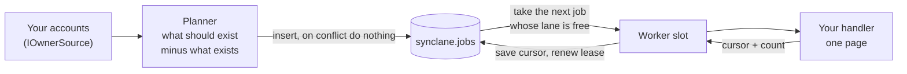
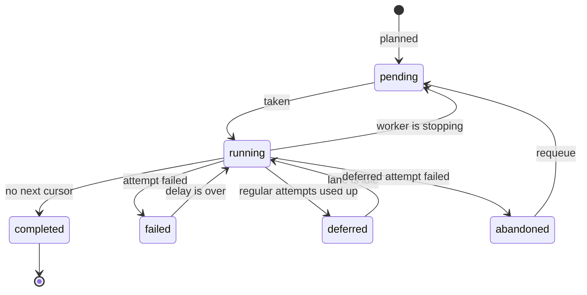
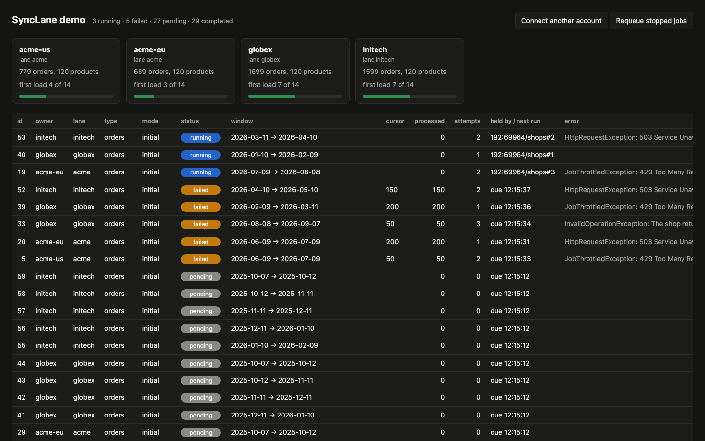

<p align="center"></p>

# SyncLane

[](https://github.com/ferhatblnk/synclane/actions/workflows/ci.yml)
[](LICENSE)
[](https://dotnet.microsoft.com/)
[](.github/workflows/ci.yml)

**A small job scheduler for syncing data from other people's APIs. Every job is one row in a PostgreSQL table you own: its window, its cursor, its attempts, its error.**

If your application pulls orders, products or anything else from an external API on behalf of many accounts, you end up needing the same things: load two years of history without one request that runs for a day, pick up what is new every few minutes, continue after a crash instead of starting over, back off when the other side says "slow down", and never hit one account's rate limit from two workers at once.

SyncLane is a .NET library that does exactly that and nothing else. It has one table, about 1,200 lines of code, and no dependency beyond Npgsql and the `Microsoft.Extensions` abstractions.

## Why

Hangfire, Quartz and the like are good at "run this method at that time". A sync job is a different animal. It has a range of time it covers, a position inside that range, and a neighbour it must not overlap with. When you put that on top of a general scheduler, the interesting state ends up somewhere you cannot see: in serialized arguments, in a second table of your own, or in a lock.

SyncLane keeps that state where you can read and change it:

- **A window on every job.** History is cut into slices; each slice is a job with a start and an end. What is new gets a window that starts where the last one ended.
- **A cursor on every job.** It is saved after each page. A job that fails, is redeployed or loses its worker continues from its last page.
- **Lanes.** Jobs of one account run one after the other; accounts run side by side.
- **Rate budgets.** Requests to one account go out at the pace you declare, shared by every job and queue that calls it. When the API says "slow down", every job on that account waits, not only the one that heard it.
- **Planning that can be repeated.** The planner compares what should exist with what exists and adds the difference. Calling it a thousand times changes nothing. Raising the history from 60 days to two years fills only the gap.
- **A row you can act on.** `status`, `attempt_count`, `error`, `next_run_at`, `leased_by`. If something is stuck, `SELECT` tells you why and `UPDATE` fixes it.

## Quick start

```csharp
builder.Services.AddSyncLane(lane =>
{
    lane.ConnectionString = builder.Configuration.GetConnectionString("Postgres")!;

    lane.AddQueue("shops", queue =>
    {
        queue.Concurrency = 4;
        queue.Owners<ConnectedShops>();

        queue.Snapshot<ProductHandler>("products", every: TimeSpan.FromDays(1));

        queue.Windowed<OrderHandler>(
            "orders",
            horizon: TimeSpan.FromDays(730),
            slice: TimeSpan.FromDays(30),
            every: TimeSpan.FromMinutes(15),
            overlap: TimeSpan.FromMinutes(5));
    });
});
```

A handler does one page and says where the next one starts:

```csharp
public sealed class OrderHandler(ShopApi api, OrderStore store) : IJobHandler
{
    public async Task<JobPage> RunPageAsync(Job job, CancellationToken cancellationToken)
    {
        var page = await api.GetOrdersAsync(job.Owner, job.WindowStart, job.WindowEnd, job.Cursor, cancellationToken);
        await store.UpsertAsync(page.Orders, cancellationToken);

        return new JobPage(page.NextCursor, page.Orders.Count);
    }
}
```

And an owner source tells the planner who is connected:

```csharp
public sealed class ConnectedShops(AppDb db) : IOwnerSource
{
    public async Task<IReadOnlyList<JobOwner>> GetOwnersAsync(string queue, CancellationToken cancellationToken) =>
        await db.Shops.Where(shop => shop.IsConnected)
            .Select(shop => new JobOwner(shop.Id.ToString(), shop.SellerId, shop.Name))
            .ToListAsync(cancellationToken);
}
```

The key identifies the owner and never changes. The lane is optional: owners that share a rate limit share one. The name is optional too: the monitor shows it next to the key and finds owners by it, and a new name replaces the old one at the next planning round.

That is the whole integration. The table is created at start-up, the planner runs once a minute and the workers start pulling.

```bash
dotnet add package SyncLane
dotnet add package SyncLane.Http          # recipes instead of handlers
dotnet tool install --global SyncLane.Cli # the synclane command
dotnet add package SyncLane.AspNetCore    # the monitor over HTTP
```

## What a job looks like

This is a row from the demo, taken while it was running. The job covers one 30-day slice of an account's orders. Its second page keeps failing, so it has done 50 records, is on its fourth attempt and will run again at `next_run_at`, from cursor `50`:

```
id               | 33
queue            | shops
owner            | globex
lane             | globex
type             | orders
mode             | initial
status           | failed
priority         | 1
window_start     | 2026-08-08 00:00:00+00
window_end       | 2026-09-07 00:00:00+00
dedup_key        | initial:2026-08-08T00:00:00Z
cursor           | 50
processed_count  | 50
attempt_count    | 4
error            | InvalidOperationException: The shop returned a page that could not be read.
next_run_at      | 2026-10-07 12:15:50.548901+00
leased_by        |
lease_expires_at |
created_at       | 2026-10-07 12:15:12.39661+00
started_at       | 2026-10-07 12:15:17.621544+00
heartbeat_at     | 2026-10-07 12:15:35.045812+00
completed_at     |
```

## How it works



1. **Plan.** Once a minute the planner asks your `IOwnerSource` who is connected, reads in one query what already exists for them, and inserts what is missing. A snapshot type gets one initial job. A windowed type gets its history in slices back to the horizon, anchored to midnight UTC so that two calls on the same day produce the same slices. Each period adds one recurring job; for a windowed type its window starts where coverage ends.
2. **Take.** A worker slot takes the next job that is due and whose lane has nothing running. Urgent jobs run first, then owners moved forward, then high, normal and low; within a level, types run in the order you declared them, and within a type the newest window runs first, so what is new is never stuck behind history. The row is marked `running` with the worker's name and a lease.
3. **Run.** The handler is called page by page. After every page the cursor and the record count are saved and the lease is renewed. A heartbeat renews the lease while a slow page is in flight.
4. **Finish.** No next cursor means `completed`. An exception means `failed` and a delay that doubles with every attempt; a `JobThrottledException` means a longer delay. Attempts count since the last saved page, so a long job that fails now and then still finishes. When the regular attempts are used up the job is `deferred`: it steps aside, the rest of its lane runs, and it gets one more attempt once the lane is idle. If that fails too it is `abandoned` and waits for you.
5. **Recover.** A worker that stops hands its job back with the cursor. A worker that dies stops renewing its lease, and another worker takes the job over; the dead worker's writes are refused from then on.



[docs/how-it-works.md](docs/how-it-works.md) goes through the statements behind each step, and [docs/planning.md](docs/planning.md) explains the planning rule and the three mistakes it exists to prevent.

## Two indexes carry the guarantees

Neither guarantee depends on a lock or on code remembering to check something:

- `UNIQUE (queue, owner, type, dedup_key)` makes planning repeatable. Several instances can plan at the same moment and every job is created once.
- `UNIQUE (queue, lane) WHERE status = 'running'` makes a lane exclusive. Two workers can pick different jobs of one lane in the same instant; the database lets one through and the other asks again.

The second one is not decoration. With that index dropped, 24 workers taking jobs from 3 lanes put two jobs of one lane to work 170 times in a run of 600 jobs. With the index: zero.

## Try the demo

The demo syncs four pretend shop accounts. The pretend shop answers slowly, sometimes returns 429 or 503, and one page of one account is broken on purpose.

```bash
docker compose up --build
```

Open <http://localhost:8080>.

<p align="center">
  
</p>

Things to watch for:

- **Lanes.** `acme-us` and `acme-eu` share the lane `acme` and take turns. `globex` and `initech` run beside them.
- **Newest first.** Each account's orders arrive from the most recent month backwards.
- **Retries.** Jobs that hit a 429 or 503 turn `failed`, wait, and continue from the cursor they had reached.
- **Giving up.** One slice of `globex` fails on its second page every time. After five attempts it is `deferred`, the rest of the lane finishes, it gets its last attempt and ends `abandoned` with cursor `50`.
- **Requeue.** Press *Requeue stopped jobs*. The broken page has healed by then, and the job completes from cursor `50`, not from the start.
- **Restart.** Run `docker compose restart demo` during the first minute. The jobs that were running are `pending` again with their cursors, and continue after the restart.

The same information without the page:

```bash
docker compose exec postgres psql -U postgres -d synclane \
  -c "select id, owner, type, status, cursor, processed_count, attempt_count, error from synclane.jobs order by id"
```

<details>
<summary>Without Docker</summary>

You need the .NET 10 SDK and a PostgreSQL database the demo may create two schemas in (`synclane` and `demo`):

```bash
ConnectionStrings__Postgres="Host=localhost;Username=postgres;Database=synclane" \
  ASPNETCORE_URLS=http://localhost:8080 dotnet run --project samples/Demo
```

</details>

## Recipes instead of handlers (preview)

For APIs that list JSON records page by page, the `SyncLane.Http` package runs a job from a recipe instead of a handler you write: where the request goes, where the job's window goes into it, where the records are in the answer, how to page and how to authenticate.

```jsonc
{
  "name": "example-shop/orders",
  "request": {
    "url": "https://api.example-shop.com/v2/orders",
    "query": { "updated_after": "{{window.start}}", "updated_before": "{{window.end}}" }
  },
  "records": "$.content",
  "pagination": { "type": "cursor", "param": "cursor", "from": "$.next_cursor" },
  "auth": { "type": "bearer", "credential": "example-shop" }
}
```

```csharp
builder.Services.AddSyncLane(lane =>
{
    lane.ConnectionString = builder.Configuration.GetConnectionString("Postgres")!;
    lane.AddQueue("shops", queue =>
    {
        queue.Owners<ConnectedShops>();
        queue.Windowed<HttpRecipeHandler>("orders", horizon: TimeSpan.FromDays(365), slice: TimeSpan.FromDays(7), every: TimeSpan.FromMinutes(15));
    });
});

builder.Services.AddSyncLaneHttp(http =>
{
    http.Credentials<ShopCredentials>();   // your ICredentialStore: credentials stay in your own storage
    http.Recipe("orders", File.ReadAllText("recipes/orders.json"))
        .WriteToPostgres("shop_orders", table => table.VersionedBy("$.updated_at"));
});
```

`WriteToPostgres` creates the table and keeps one row per account and record: no DDL, no upsert to write. A page that runs twice changes nothing, and an older copy of a record never replaces a newer one. Records are keyed by `$.id` when every record has a unique one; otherwise the job stops and names the fields that could serve. `WriteToHttp(url)` posts the same records, with their keys and versions, to a service of yours. Any other store takes an `IRecordSink` of your own, and `SinkConformance.CheckAsync` tells you, in a test, whether it survives pages written twice.

- **Paging:** page number, offset, cursor, next URL, `Link` header. **Auth:** bearer, basic, API key, OAuth 2.0 (client credentials and refresh token), signed requests.
- A recipe holds no secret and can only call the hosts it names. Values per owner (a marketplace, a region) and a host per owner, from a list, come from your owner source. Every problem in a recipe is reported, with a code, before anything runs.
- Checked against five public APIs, one per paging style: [samples/LiveCheck](samples/LiveCheck).
- Not covered yet: multi-step flows (start a report, wait, download), GraphQL, XML or CSV answers. Write a handler for those; the engine is the same.

You do not have to write the first recipe yourself. Put `synclane init` in front of a curl that works, and it sends the request once and writes the recipe from what the answer shows, with a comment above every field it inferred. `synclane test orders.jsonc` then runs the recipe for two pages without a database, and says whether the records, the key and the paging work ([Starting from a curl](docs/recipes.md#starting-from-a-curl)).

Or let an AI assistant write it. `synclane mcp` gives your assistant those commands as tools over the Model Context Protocol: it drafts the recipe from your curl, checks it, runs it for two pages and fixes what the results say. It runs on your machine with your own assistant; SyncLane calls no AI service, and a token you write as `$NAME` in the curl is read from the environment, so it never enters the conversation. Any assistant can also start from [llms.txt](llms.txt). See [docs/ai.md](docs/ai.md).

The whole format: [docs/recipes.md](docs/recipes.md). Add `"$schema"` to a recipe and your editor completes, explains and checks every field as you type ([schemas/recipe.schema.json](schemas/recipe.schema.json)).

## Working with jobs from your code

`ISyncLane` is the only service you inject. Every call returns a result instead of throwing for problems you can expect:

| Call | Returns | What it is for |
| --- | --- | --- |
| `PlanAsync(queue, owner)` | `SyncResult<int>` | Plan one owner now, for example right after an account connects. |
| `EnqueueAsync(newJob)` | `SyncResult<long>` | Put one job in by hand, outside the plan. The value is the new job's id. |
| `RequeueAsync(queue, owner?)` | `SyncResult<int>` | Give failed, deferred and abandoned jobs fresh attempts. Cursors are kept. |
| `CancelAsync(queue, owner, reason)` | `SyncResult<int>` | Abandon what has not started, for example when an account disconnects. |
| `GetJobsAsync(query)` | `SyncListResult<Job>` | One page of jobs by queue, owner, status or type, newest first, or of the owners whose name or key contains `Search` ("acme" finds every store of "Acme Toys"). Follow `NextCursor` for the next page; set `IncludeTotal` for a count. |
| `GetProgressAsync(queue, owner)` | `SyncResult<OwnerProgress>` | How far the first load of an owner is. Use it to show "connecting" without storing a status of your own. |
| `MarkLoadedAsync(queue, ranges)` | `SyncResult<int>` | Moving from another system: record the history it already loaded, so only what is older and what came after is fetched. |
| `ForgetOwnerAsync(queue, owner)` | `SyncResult<int>` | Delete everything about an owner that is gone for good. If it comes back, its history loads again. |

```csharp
var result = await syncLane.EnqueueAsync(new NewJob { Queue = "shops", Owner = owner, Type = "orders", DedupKey = "resync-2026-10" });

if (!result.Succeeded)
    return result.Error!.Code == SyncErrorCodes.JobAlreadyExists
        ? Results.Ok("Already queued")
        : Results.Problem(result.Error.Message, statusCode: result.Error.Kind.ToHttpStatusCode());

return Results.Ok(result.Value);
```

### Priority

Jobs that are due run in this order: `Urgent` jobs, then the owners an operator moved forward with `PrioritizeOwnerAsync`, then `High`, `Normal` and `Low`. Within a level, types run in the order you declared them. A job takes its level from `NewJob.Priority`, or else from its owner:

```csharp
// A stock change that must reach the marketplace before anything else in line.
await syncLane.EnqueueAsync(new NewJob { Queue = "shops", Owner = owner, Type = "inventory", Priority = JobPriority.Urgent });

// A new customer whose history should load before the others: give it from your owner source.
return accounts
    .Select(account => new JobOwner(account.Id, Name: account.Name) { Priority = account.IsNew ? JobPriority.High : JobPriority.Normal })
    .ToList();
```

An owner's priority applies to the jobs created after it changes; jobs already waiting keep theirs. Priority never cuts a running job: one account's jobs share a lane, so an urgent job of that account runs as soon as the job in its lane ends. `Job.PriorityLevel` and `Job.Prioritized` show where a job stands.

A failed result always means the call was understood and the answer is no: an undeclared queue, a duplicate job, a page size out of range. It never hides an outage; a database that cannot be reached still throws. Every error has a stable code such as `SL3101`, listed with its cause and fix in [docs/errors.md](docs/errors.md). Call `ThrowIfFailed()` or `GetValueOrThrow()` when you would rather have an exception.

Three exceptions let a handler say more than "it failed":

- `JobThrottledException` when the other side asks you to slow down, optionally with the wait it named.
- `JobAbandonedException` when a retry cannot help, for example when the account's access was revoked.
- `JobPostponedException` when the job only has to wait: it gives its slot back without using an attempt and continues from its cursor later. A rate budget throws it for you when a token is far away, and so does a recipe with a budget when the API says "slow down". A hand-written handler does the same after `ThrottledAsync`: `throw new JobPostponedException(reason, pause)`.

## Rate budgets

An API's limit belongs to an account, not to a job. Declare it once, and every job that calls the account draws from it:

```csharp
builder.Services.AddSyncLane(lane =>
{
    lane.AddBudget("example-shop", limit: 2, per: TimeSpan.FromSeconds(1), burst: 40);
    lane.AddQueue("shops", queue => { /* ... */ });
});
```

A recipe draws from it with `"rate": { "budget": "example-shop" }`. A hand-written handler calls `RateBudgets` before each request, and hands the permit back when the API answered `429`:

```csharp
var permit = await budgets.WaitAsync("example-shop", job.Owner, cancellationToken);
// ... send the request ...
if (response.StatusCode == HttpStatusCode.TooManyRequests)
    await budgets.ThrottledAsync(permit, response.Headers.RetryAfter?.Delta, cancellationToken);
```

- **One bucket per budget and key**, usually the owner. Owners that share one set of credentials pass one key.
- **Shared by every instance.** Buckets live in the `rate_buckets` table, so two instances together keep to the limit you declared, not twice it. Taking a token is one short statement, about 0.2 ms against a local database.
- **A `429` pauses the whole bucket** for `Retry-After`, or one token's time, at least a second. Every job on the key, on every instance, waits; then the bucket goes on at 0.7 times its rate and climbs back while requests go through. The pause doubles, up to five minutes, only while the first request after each pause is refused again. Requests that were already on their way when the pause began do not count again.
- **The limit is a ceiling, and the budget learns how much of it is safe.** A budget whose limit is right never sees a `429` and never changes. One whose limit is too high, or shared with another app, settles below it. For a limit nobody publishes, declare a generous ceiling and start lower: `AddBudget("example-shop", limit: 20, per: TimeSpan.FromSeconds(1), start: 0.25)`. Against simulated APIs with hidden limits it kept `429`s under 1% and reached 95 to 100% of the limit; it has not yet met a real one.
- **A wait longer than `MaxBudgetWait`** (30 seconds) gives the job's slot back without using an attempt, so a paused budget never holds workers.
- **What the API says counts too.** A recipe can name the headers in which the API says how many requests are left and when more come; the budget then stops at zero instead of running into a `429`, and notices another app spending the same quota. A hand-written handler passes the same numbers to `budgets.ReportRemainingAsync(permit, remaining, resetsIn)`. Those readings only ever lower the budget. See [docs/recipes.md](docs/recipes.md#reading-what-the-api-says).
- **A limit the API reports replaces the declared one**, up or down, on every instance: name its header in the recipe (`rate.headers.limit`), or call `budgets.ReportLimitAsync(permit, limit, per)` from a handler. When the API raises its limit, SyncLane follows without a deploy.
- **An operator can lower a budget for a while**, without a deploy: `monitor.LimitBudgetAsync("example-shop", key: null, limit: 30, per: TimeSpan.FromMinutes(1), reason: "the API answers slowly", until: ...)`. It never raises one.


## Watching it run

`ISyncLaneMonitor` answers what an operator asks, for every queue in the schema, whichever application runs it:

| Call | Answers |
| --- | --- |
| `GetOverviewAsync()` | One line per queue: due, postponed, running, retrying, deferred and abandoned jobs; owners; live instances; jobs, records and failures in the last 24 hours. |
| `GetFreshnessAsync(query)` | Owners ranked by how old their newest completed data is, each with the job that explains it (its status, error code and next run) and how much of its history has loaded. `Search` finds owners by name or key. |
| `GetProblemsAsync(queue?)` | Failing, deferred and abandoned jobs grouped by error code: "SL5106: 37 jobs, 12 owners" instead of 37 rows. |
| `GetBudgetsAsync(query)` | Each rate budget and key: the rate it learned, the limit the API reports and any operator's limit, whether it is paused, when it was last refused. |
| `GetInstancesAsync()` | Every process of every application: host, version, queues, and whether it is alive, stopped (and when) or gone without stopping. Stopped and gone ones stay listed for a day. |
| `GetVolumeAsync(query)` | Completed jobs, records, failed attempts and abandoned jobs per hour or day, kept for 400 days. |

```csharp
var behind = await monitor.GetFreshnessAsync(new FreshnessQuery { Queue = "shops", Limit = 20 });
foreach (var row in behind.Items)
    Console.WriteLine($"{row.Owner} {row.Type}: data until {row.DataUntil:u}, {row.Status} {row.Code}");
```

`WatchAsync(queue?, owner?)` streams jobs as they are created and change status, from every instance, a moment after each change commits, so a live view or an alert needs no polling:

```csharp
await foreach (var change in monitor.WatchAsync("shops", cancellationToken: stopping))
    await hub.Clients.All.SendAsync("job", change.Id, change.Owner, change.Status.ToString(), stopping);
```

Over HTTP, `SyncLane.AspNetCore` maps all of it in one line, with the stream as server-sent events. The endpoints show up in your OpenAPI (Swagger) document under `SyncLane`, and answer only requests from the same machine until you require authorization:

```csharp
app.MapSyncLane("/synclane").RequireAuthorization("ops");
```

See [the package's readme](src/SyncLane.AspNetCore/README.md) for the routes.

It also has an emergency stop, `PauseAsync(queue, owner?, reason)`, which cuts what runs on every instance and takes nothing more until `ResumeAsync`, and the repairs the answers call for: `RequeueJobAsync(id)`, `RestartJobAsync(id)` to fetch a window again, `RequeueByCodeAsync(queue, code)` after fixing what a problem group shows, `PrioritizeOwnerAsync(queue, owner)` for an account that should load first, and `SyncNowAsync(queue, owner, type)` when the other side announces a change, for example with a webhook: it fetches from where the owner's data reaches to now, at high priority, and a burst of calls is one fetch. `LimitBudgetAsync` lowers a rate budget for a while. Every action is logged with who did it and why (`GetActionsAsync`). See [docs/operations.md](docs/operations.md#changing).

Each read is one round trip that reads small summary tables and the open jobs, never the history: on a table of a million jobs each one takes about a millisecond, and a year of daily volume about 45. Lists page with a cursor.

SyncLane also reports metrics and traces through the APIs built into .NET, so it adds no dependency and costs nothing when nobody listens. With OpenTelemetry:

```csharp
builder.Services.AddOpenTelemetry()
    .WithMetrics(metrics => metrics.AddMeter(SyncLaneTelemetry.MeterName))
    .WithTracing(tracing => tracing.AddSource(SyncLaneTelemetry.ActivitySourceName));
```

Every run of a job is a `synclane.job` span and every page a `synclane.page` span inside it, so the HTTP calls your handler makes show up under the page that made them. The metrics count jobs taken and finished by outcome, pages, records, throttles and planner runs, and time how long jobs wait and run. Tags name the queue and the job type, never the owner or the lane. Without OpenTelemetry, `dotnet-counters monitor --counters SyncLane` shows them live. The full list is in [docs/operations.md](docs/operations.md#metrics-and-traces).

### Health checks

`AddSyncLane` provides `SyncLaneHealthCheck` for .NET's health checks, in a web app or a worker:

```csharp
builder.Services.AddHealthChecks().AddCheck<SyncLaneHealthCheck>("synclane");
app.MapHealthChecks("/health");
```

- **Unhealthy** when the database cannot be reached, its schema lacks migrations this version needs, or this instance has not renewed its registration for two minutes, after which other instances count it as gone.
- **Degraded** while it starts, when the latest planning round of a queue failed, or when it does not hear job changes (behind a pooler in transaction mode without `ListenConnectionString`, or while it reconnects). Workers still find jobs by polling then.
- Each check is one small query. Descriptions say what is wrong and how to fix it; they never hold a connection string or an exception's message.

## Configuration

| Setting | Default | What it does |
| --- | --- | --- |
| `ConnectionString` | required | The database that holds the table. |
| `ListenConnectionString` | `ConnectionString` | The same database, for the one connection per process that hears job changes. Set it when `ConnectionString` goes through a pooler in transaction mode. See [Behind a connection pooler](docs/operations.md#behind-a-connection-pooler). |
| `ListenForChanges` | `true` | Turn it off where no connection can listen: workers then look for jobs every `PollInterval`, and nothing is opened or sent to hear changes. |
| `Schema` | `synclane` | The schema of the `jobs` table. |
| `CreateSchema` | `true` | Create the schema and apply missing migrations at start-up. Turn it off if you manage migrations: put `SyncLaneSchema.Script()` into one of yours, and SyncLane only checks at start-up that it has been applied. See [docs/operations.md](docs/operations.md#running-the-schema-yourself). |
| `RunPlanner`, `RunWorkers` | `true` | Turn them off in instances that should only enqueue and read. |
| `PlanInterval` | 1 minute | How often the planner looks for missing jobs. |
| `PollInterval` | 5 seconds | How long an idle worker slot waits before it looks again. A job created or put back in line wakes it at once, from any instance. |
| `AddBudget(name, limit, per, burst, start)` | none | A rate budget: at most `limit` requests per `per`, at most `burst` at once (default 1, evenly spaced). It starts at `start` times the limit (default 1) and learns below it. |
| `Application` | the host's application name | The name instances register under. Copies of one application share its queues; another application that runs one of them is refused at start-up. See [Several applications on one schema](docs/operations.md#several-applications-on-one-schema). |
| `KeepCompletedJobs` | 7 days | How long completed recurring and manual jobs stay before instances that run the planner delete them. Initial jobs and unfinished jobs stay. `null` keeps everything. |
| `MaxBudgetWait` | 30 seconds | The longest a request waits for a budget's token inside a job; a longer wait postpones the job. |
| `queue.Concurrency` | `1` | Jobs of the queue one process runs at once. `1` makes the queue strictly sequential. |
| `queue.MaxAttempts` | `5` | Attempts in a row without saving a page before a job is deferred. |
| `queue.LeaseDuration` | 5 minutes | How long a silent worker keeps its job. |
| `queue.RetryBaseDelay`, `RetryMaxDelay` | 1 minute, 1 hour | Delay after a failure: base, doubled per attempt, capped. |
| `queue.ThrottleBaseDelay`, `ThrottleMaxDelay` | 5 minutes, 30 minutes | The same for a `JobThrottledException` that names no wait. |

### Settings from configuration

The code declares queues, job types, handlers and budgets. Their numbers can then come from configuration, per environment, without a deploy:

```csharp
builder.Services.AddSyncLane(builder.Configuration.GetSection("SyncLane"), lane =>
{
    lane.ConnectionString = builder.Configuration.GetConnectionString("Postgres")!;
    lane.AddBudget("shop-api", limit: 2, per: TimeSpan.FromSeconds(1), burst: 40);
    lane.AddQueue("shops", queue => queue
        .Owners<ConnectedShops>()
        .Windowed<OrderHandler>("orders", horizon: TimeSpan.FromDays(730), slice: TimeSpan.FromDays(30), every: TimeSpan.FromMinutes(15)));
});
```

```json
"SyncLane": {
  "RunWorkers": false,
  "Queues": {
    "shops": {
      "Concurrency": 4,
      "Types": { "orders": { "Every": "00:05:00", "Slice": "7.00:00:00" } }
    }
  },
  "Budgets": { "shop-api": { "Limit": 4 } }
}
```

- Everything in the table above can be set: top-level settings by name, `Queues:<queue>` for a queue, `Queues:<queue>:Types:<type>` for `Horizon`, `Slice`, `Every`, `Overlap` and `Offset`, and `Budgets:<budget>` for `Limit`, `Per`, `Burst` and `Start`.
- Configuration overrides what the code declares and never adds to it. A queue, type, budget or setting the code does not know stops the start with `SL1012`, naming its path, so a typo never passes silently. Every problem is reported at once.
- Names ignore case, as configuration keys do, so an environment variable such as `SYNCLANE__QUEUES__SHOPS__CONCURRENCY=4` works.
- Time spans are written `hh:mm:ss` or `d.hh:mm:ss`. A value that cannot be read stops the start with `SL1013`, which names the path but never the value.
- The values are checked like values from code.

## What it promises

- **A page is handled at least once**, not exactly once. A crash between your write and the cursor save makes the page run again. Write with upserts.
- **One job per lane at a time**, across every process that shares the table.
- **A planned job is created once**, however many instances plan and however often.
- **Nothing is lost on shutdown or crash.** The cursor on the row is where the job continues.

## Limitations

- **PostgreSQL only.** The lease is a single statement that relies on `FOR UPDATE SKIP LOCKED` and partial unique indexes.
- **Live changes need a connection that can listen.** Workers wake and `WatchAsync` streams through PostgreSQL's `LISTEN`, which a pooler in transaction mode accepts and never delivers. SyncLane notices at start-up, logs a warning and polls every `PollInterval`. Set `ListenConnectionString` to the server itself, or to a pooler in session mode, and everything else can stay behind the pooler. See [docs/operations.md](docs/operations.md#behind-a-connection-pooler).
- **No job arguments.** A job knows its owner, type and window. Anything else the handler needs it looks up from the owner.
- **Periods are aligned to the clock.** "Every day" means once per UTC day, so the first refresh after a first load can come sooner than a full period.
- **Clocks.** Leases and rate budgets use the clock of the instance. Keep your instances on NTP; a lease of minutes is not sensitive to a skew of seconds, but a budget is: an instance whose clock runs a second ahead can let one second's worth of extra tokens through.
- **Initial jobs stay.** Completed recurring and manual jobs are deleted after `KeepCompletedJobs`; initial jobs, one per slice of history, are kept as the record of what was loaded. A two-year horizon in 30-day slices is 25 rows per owner and type. See [docs/operations.md](docs/operations.md#keeping-the-table-small).
- **No dashboard.** The demo has a single page built on `GetJobsAsync`; the table itself is the real interface.

## Project status

Version 0.4, early. Before 1.0 a minor version may still change the API; every such change is listed under its version in [CHANGELOG.md](CHANGELOG.md). The design comes from a job system that has been syncing external APIs for many accounts in production, and the rules in [docs/planning.md](docs/planning.md) were learned there the hard way. This repository is a clean, general rewrite of that design. It has its own tests, including ones that run many workers against a real PostgreSQL, but this code has not run in production itself. Try it on something that is allowed to fail first; [docs/production-trial.md](docs/production-trial.md) is the checklist we use for that. `SyncLane.Http` is newer still: it has synced five public APIs, not yet the APIs of a production integration.

## Development

```bash
dotnet build
dotnet test
```

Tests that need PostgreSQL are skipped unless `SYNCLANE_TEST_DB` holds a connection string. Each test creates a schema of its own and drops it afterwards:

```bash
SYNCLANE_TEST_DB="Host=localhost;Username=postgres;Database=synclane_test" dotnet test
```

| Folder | Contents |
| --- | --- |
| `src/SyncLane` | The library: planner, table access, runner and workers. |
| `tests/SyncLane.Tests` | Unit tests and the tests that run against PostgreSQL. |
| `samples/Demo` | The demo: a pretend shop, two handlers and one page. |
| `docs` | How it works, the planning rule, operations, the schema, the production trial checklist and design proposals. |

Contributions are welcome; see [CONTRIBUTING.md](CONTRIBUTING.md). To report a vulnerability, see [SECURITY.md](SECURITY.md).

## Your responsibility

SyncLane is a library. It runs inside your process, with the credentials you give it, against the database and the destinations you choose. It sends nothing to the SyncLane authors: there is no telemetry, no license check that calls home and no hosted service in between. Your data never passes through anyone but you.

That also means the decisions are yours. When you use SyncLane, you are responsible for:

- **Your right to call the API.** Having an account or app registration with the provider, accepting its terms, and staying within the limits and uses it allows.
- **The pace you choose.** Concurrency, windows, retries and delays are settings. SyncLane applies them; it does not know what a provider tolerates. Start slow on an account that matters.
- **Your credentials.** Where they are stored, who can read them and when they are rotated. Recipes ask your `ICredentialStore` for them page by page; SyncLane stores none.
- **The data you pull and where you write it.** Including personal data and the laws that apply to it where you and your users are, such as the GDPR or Turkey's KVKK: what you keep, for how long and who may see it.
- **What your handlers do.** SyncLane calls your code; it does not review it.

Anything in this repository that describes a third-party API, including the demo and any example, is an illustration written by contributors. It is not a statement by the provider and may be out of date. Check the provider's own documentation before you rely on it.

## License

[Apache License 2.0](LICENSE). The software is provided on an "AS IS" basis, without warranties or conditions of any kind, and no contributor is liable for damages arising from its use; sections 7 and 8 of the license state this in full.

SyncLane is free to use, with no registration, account or paid edition, and it calls no host of its own: no telemetry, no license check, no update check.

SyncLane is an independent open-source project. It is not affiliated with, endorsed by or supported by the PostgreSQL project or any API provider.
