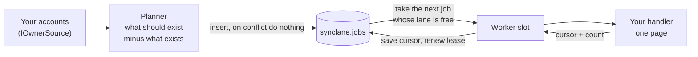
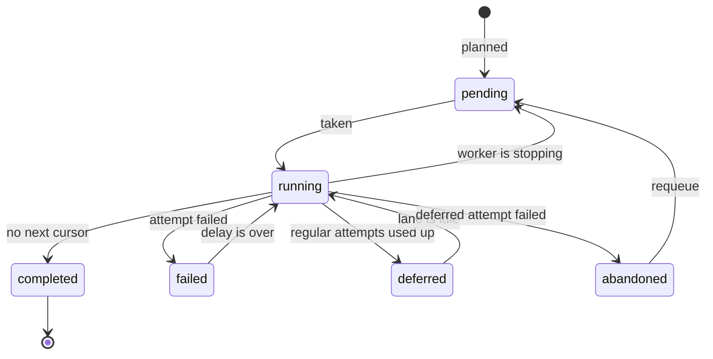
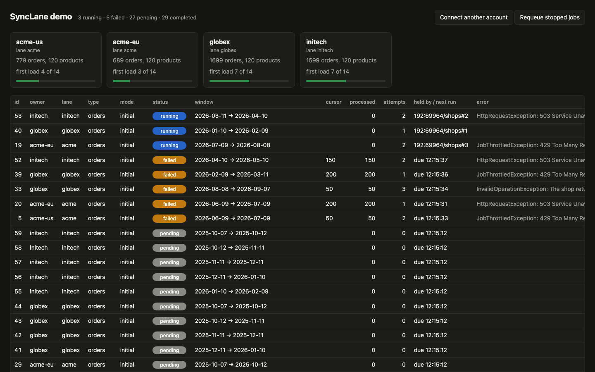

# SyncLane

**A small job scheduler for syncing data from other people's APIs. Every job is one row in a PostgreSQL table you own: its window, its cursor, its attempts, its error.**

If your application pulls orders, products or anything else from an external API on behalf of many accounts, you end up needing the same things: load two years of history without one request that runs for a day, pick up what is new every few minutes, continue after a crash instead of starting over, back off when the other side says "slow down", and never hit one account's rate limit from two workers at once.

SyncLane is a .NET library that does exactly that and nothing else. It has one table, about 1,200 lines of code, and no dependency beyond Npgsql and the `Microsoft.Extensions` abstractions.

## Why

Hangfire, Quartz and the like are good at "run this method at that time". A sync job is a different animal. It has a range of time it covers, a position inside that range, and a neighbour it must not overlap with. When you put that on top of a general scheduler, the interesting state ends up somewhere you cannot see: in serialized arguments, in a second table of your own, or in a lock.

SyncLane keeps that state where you can read and change it:

- **A window on every job.** History is cut into slices; each slice is a job with a start and an end. What is new gets a window that starts where the last one ended.
- **A cursor on every job.** It is saved after each page. A job that fails, is redeployed or loses its worker continues from its last page.
- **Lanes.** Jobs of one account run one after the other; accounts run side by side. Accounts that share a rate limit can share a lane.
- **Planning that can be repeated.** The planner compares what should exist with what exists and adds the difference. Calling it a thousand times changes nothing. Raising the history from 60 days to two years fills only the gap.
- **A row you can act on.** `status`, `attempt_count`, `error`, `next_run_at`, `leased_by`. If something is stuck, `SELECT` tells you why and `UPDATE` fixes it.

## Quick start

```csharp
builder.Services.AddSyncLane(lane =>
{
    lane.ConnectionString = builder.Configuration.GetConnectionString("Postgres")!;

    lane.AddQueue("shops", queue =>
    {
        queue.Concurrency = 4;
        queue.Owners<ConnectedShops>();

        queue.Snapshot<ProductHandler>("products", every: TimeSpan.FromDays(1));

        queue.Windowed<OrderHandler>(
            "orders",
            horizon: TimeSpan.FromDays(730),
            slice: TimeSpan.FromDays(30),
            every: TimeSpan.FromMinutes(15),
            overlap: TimeSpan.FromMinutes(5));
    });
});
```

A handler does one page and says where the next one starts:

```csharp
public sealed class OrderHandler(ShopApi api, OrderStore store) : IJobHandler
{
    public async Task<JobPage> RunPageAsync(Job job, CancellationToken cancellationToken)
    {
        var page = await api.GetOrdersAsync(job.Owner, job.WindowStart, job.WindowEnd, job.Cursor, cancellationToken);
        await store.UpsertAsync(page.Orders, cancellationToken);

        return new JobPage(page.NextCursor, page.Orders.Count);
    }
}
```

And an owner source tells the planner who is connected:

```csharp
public sealed class ConnectedShops(AppDb db) : IOwnerSource
{
    public async Task<IReadOnlyList<JobOwner>> GetOwnersAsync(string queue, CancellationToken cancellationToken) =>
        await db.Shops.Where(shop => shop.IsConnected)
            .Select(shop => new JobOwner(shop.Id.ToString(), shop.SellerId))
            .ToListAsync(cancellationToken);
}
```

That is the whole integration. The table is created at start-up, the planner runs once a minute and the workers start pulling. SyncLane is not on NuGet yet; reference the project or run `dotnet pack src/SyncLane`.

## What a job looks like

This is a row from the demo, taken while it was running. The job covers one 30-day slice of an account's orders. Its second page keeps failing, so it has done 50 records, is on its fourth attempt and will run again at `next_run_at`, from cursor `50`:

```
id               | 33
queue            | shops
owner            | globex
lane             | globex
type             | orders
mode             | initial
status           | failed
priority         | 1
window_start     | 2026-08-08 00:00:00+00
window_end       | 2026-09-07 00:00:00+00
dedup_key        | initial:2026-08-08T00:00:00Z
cursor           | 50
processed_count  | 50
attempt_count    | 4
error            | InvalidOperationException: The shop returned a page that could not be read.
next_run_at      | 2026-10-07 12:15:50.548901+00
leased_by        |
lease_expires_at |
created_at       | 2026-10-07 12:15:12.39661+00
started_at       | 2026-10-07 12:15:17.621544+00
heartbeat_at     | 2026-10-07 12:15:35.045812+00
completed_at     |
```

## How it works



1. **Plan.** Once a minute the planner asks your `IOwnerSource` who is connected, reads in one query what already exists for them, and inserts what is missing. A snapshot type gets one initial job. A windowed type gets its history in slices back to the horizon, anchored to midnight UTC so that two calls on the same day produce the same slices. Each period adds one recurring job; for a windowed type its window starts where coverage ends.
2. **Take.** A worker slot takes the next job that is due and whose lane has nothing running. Types run in the order you declared them; within a type the newest window runs first, so what is new is never stuck behind history. The row is marked `running` with the worker's name and a lease.
3. **Run.** The handler is called page by page. After every page the cursor and the record count are saved and the lease is renewed. A heartbeat renews the lease while a slow page is in flight.
4. **Finish.** No next cursor means `completed`. An exception means `failed` and a delay that doubles with every attempt; a `JobThrottledException` means a longer delay. When the regular attempts are used up the job is `deferred`: it steps aside, the rest of its lane runs, and it gets one more attempt once the lane is idle. If that fails too it is `abandoned` and waits for you.
5. **Recover.** A worker that stops hands its job back with the cursor. A worker that dies stops renewing its lease, and another worker takes the job over; the dead worker's writes are refused from then on.



[docs/how-it-works.md](docs/how-it-works.md) goes through the statements behind each step, and [docs/planning.md](docs/planning.md) explains the planning rule and the three mistakes it exists to prevent.

## Two indexes carry the guarantees

Neither guarantee depends on a lock or on code remembering to check something:

- `UNIQUE (queue, owner, type, dedup_key)` makes planning repeatable. Several instances can plan at the same moment and every job is created once.
- `UNIQUE (queue, lane) WHERE status = 'running'` makes a lane exclusive. Two workers can pick different jobs of one lane in the same instant; the database lets one through and the other asks again.

The second one is not decoration. With that index dropped, 24 workers taking jobs from 3 lanes put two jobs of one lane to work 170 times in a run of 600 jobs. With the index: zero.

## Try the demo

The demo syncs four pretend shop accounts. The pretend shop answers slowly, sometimes returns 429 or 503, and one page of one account is broken on purpose.

```bash
docker compose up --build
```

Open <http://localhost:8080>.

<p align="center">
  
</p>

Things to watch for:

- **Lanes.** `acme-us` and `acme-eu` share the lane `acme` and take turns. `globex` and `initech` run beside them.
- **Newest first.** Each account's orders arrive from the most recent month backwards.
- **Retries.** Jobs that hit a 429 or 503 turn `failed`, wait, and continue from the cursor they had reached.
- **Giving up.** One slice of `globex` fails on its second page every time. After five attempts it is `deferred`, the rest of the lane finishes, it gets its last attempt and ends `abandoned` with cursor `50`.
- **Requeue.** Press *Requeue stopped jobs*. The broken page has healed by then, and the job completes from cursor `50`, not from the start.
- **Restart.** Run `docker compose restart demo` during the first minute. The jobs that were running are `pending` again with their cursors, and continue after the restart.

The same information without the page:

```bash
docker compose exec postgres psql -U postgres -d synclane \
  -c "select id, owner, type, status, cursor, processed_count, attempt_count, error from synclane.jobs order by id"
```

<details>
<summary>Without Docker</summary>

You need the .NET 10 SDK and a PostgreSQL database the demo may create two schemas in (`synclane` and `demo`):

```bash
ConnectionStrings__Postgres="Host=localhost;Username=postgres;Database=synclane" \
  ASPNETCORE_URLS=http://localhost:8080 dotnet run --project samples/Demo
```

</details>

## Working with jobs from your code

`ISyncLane` is the only service you inject:

| Call | What it is for |
| --- | --- |
| `PlanAsync(queue, owner)` | Plan one owner now, for example right after an account connects. |
| `EnqueueAsync(newJob)` | Put one job in by hand, outside the plan. |
| `RequeueAsync(queue, owner?)` | Give failed, deferred and abandoned jobs fresh attempts. Cursors are kept. |
| `CancelAsync(queue, owner, reason)` | Abandon what has not started, for example when an account disconnects. |
| `GetJobsAsync(query)` | List jobs by queue, owner or status. |
| `GetProgressAsync(queue, owner)` | How far the first load of an owner is. Use it to show "connecting" without storing a status of your own. |

Two exceptions let a handler say more than "it failed":

- `JobThrottledException` when the other side asks you to slow down, optionally with the wait it named.
- `JobAbandonedException` when a retry cannot help, for example when the account's access was revoked.

## Configuration

| Setting | Default | What it does |
| --- | --- | --- |
| `ConnectionString` | required | The database that holds the table. |
| `Schema` | `synclane` | The schema of the `jobs` table. |
| `CreateSchema` | `true` | Create the table and indexes at start-up. Turn it off and run [docs/schema.sql](docs/schema.sql) yourself if you manage migrations. |
| `RunPlanner`, `RunWorkers` | `true` | Turn them off in instances that should only enqueue and read. |
| `PlanInterval` | 1 minute | How often the planner looks for missing jobs. |
| `PollInterval` | 5 seconds | How long an idle worker slot waits before it looks again. |
| `queue.Concurrency` | `1` | Jobs of the queue one process runs at once. `1` makes the queue strictly sequential. |
| `queue.MaxAttempts` | `5` | Regular attempts before a job is deferred. |
| `queue.LeaseDuration` | 5 minutes | How long a silent worker keeps its job. |
| `queue.RetryBaseDelay`, `RetryMaxDelay` | 1 minute, 1 hour | Delay after a failure: base, doubled per attempt, capped. |
| `queue.ThrottleBaseDelay`, `ThrottleMaxDelay` | 5 minutes, 30 minutes | The same for a `JobThrottledException` that names no wait. |

## What it promises

- **A page is handled at least once**, not exactly once. A crash between your write and the cursor save makes the page run again. Write with upserts.
- **One job per lane at a time**, across every process that shares the table.
- **A planned job is created once**, however many instances plan and however often.
- **Nothing is lost on shutdown or crash.** The cursor on the row is where the job continues.

## Limitations

- **PostgreSQL only.** The lease is a single statement that relies on `FOR UPDATE SKIP LOCKED` and partial unique indexes.
- **Workers poll.** An idle slot asks once per `PollInterval`. There is no `LISTEN`/`NOTIFY` yet.
- **No job arguments.** A job knows its owner, type and window. Anything else the handler needs it looks up from the owner.
- **Periods are aligned to the clock.** "Every day" means once per UTC day, so the first refresh after a first load can come sooner than a full period.
- **Clocks.** Leases are compared with the clock of the instance. Keep your instances on NTP; a lease of minutes is not sensitive to a skew of seconds.
- **The table only grows.** Deleting old rows is up to you, and initial rows are the record of what has been loaded. See [docs/operations.md](docs/operations.md).
- **No dashboard.** The demo has a single page built on `GetJobsAsync`; the table itself is the real interface.

## Project status

Version 0.1, early. The design comes from a job system that has been syncing external APIs for many accounts in production, and the rules in [docs/planning.md](docs/planning.md) were learned there the hard way. This repository is a clean, general rewrite of that design. It has its own tests, including ones that run many workers against a real PostgreSQL, but this code has not run in production itself. Try it on something that is allowed to fail first.

## Development

```bash
dotnet build
dotnet test
```

Tests that need PostgreSQL are skipped unless `SYNCLANE_TEST_DB` holds a connection string. Each test creates a schema of its own and drops it afterwards:

```bash
SYNCLANE_TEST_DB="Host=localhost;Username=postgres;Database=synclane_test" dotnet test
```

| Folder | Contents |
| --- | --- |
| `src/SyncLane` | The library: planner, table access, runner and workers. |
| `tests/SyncLane.Tests` | Unit tests and the tests that run against PostgreSQL. |
| `samples/Demo` | The demo: a pretend shop, two handlers and one page. |
| `docs` | How it works, the planning rule, operations and the schema. |

Contributions are welcome; see [CONTRIBUTING.md](CONTRIBUTING.md). To report a vulnerability, see [SECURITY.md](SECURITY.md).

## License

[MIT](LICENSE). The software is provided as is, without warranty of any kind.

SyncLane is an independent open-source project. It is not affiliated with, endorsed by or supported by the PostgreSQL project or any API provider.
